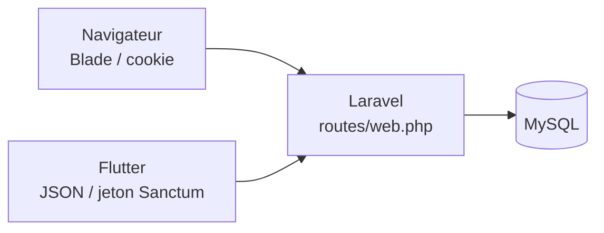
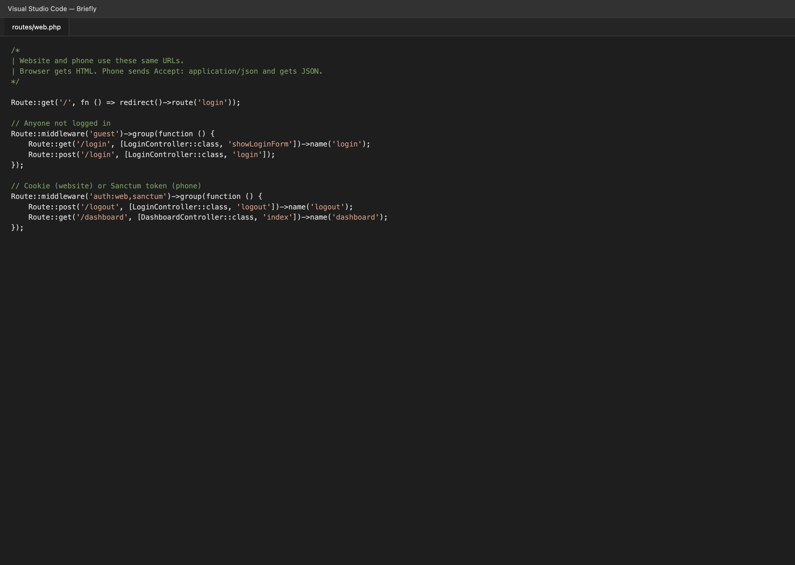
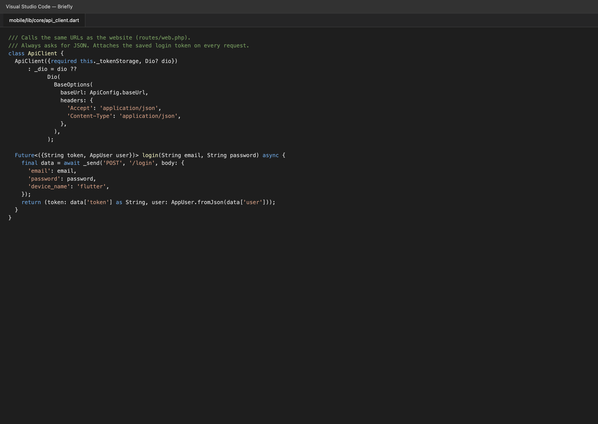
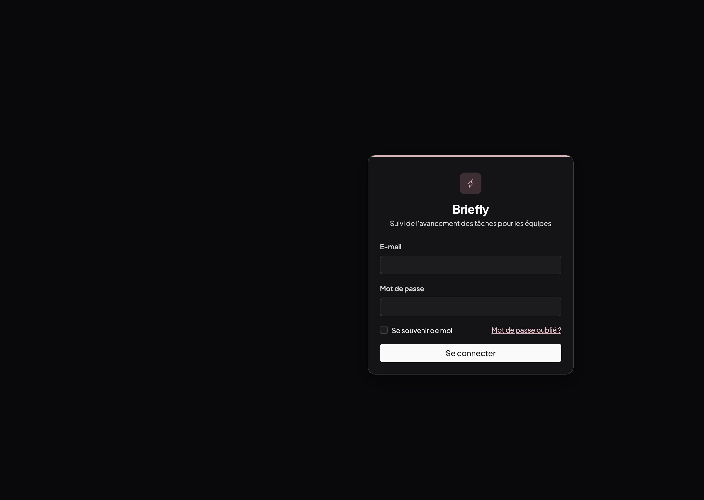
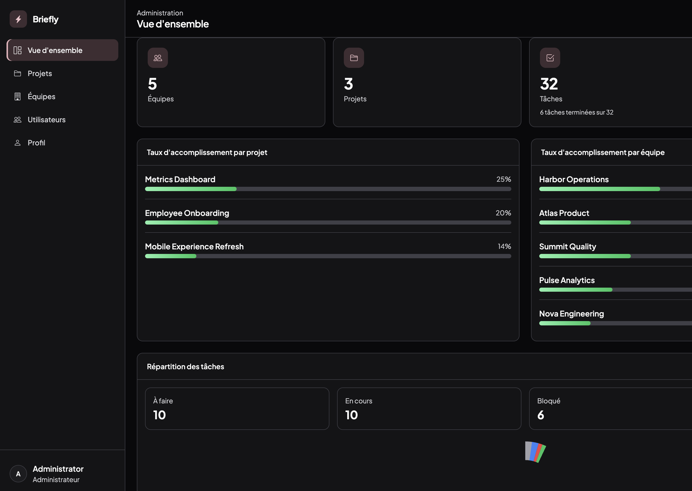
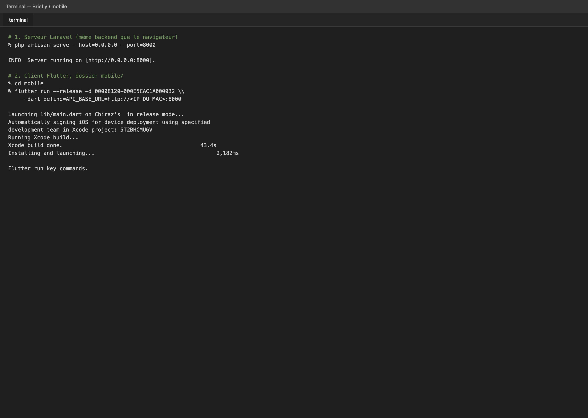
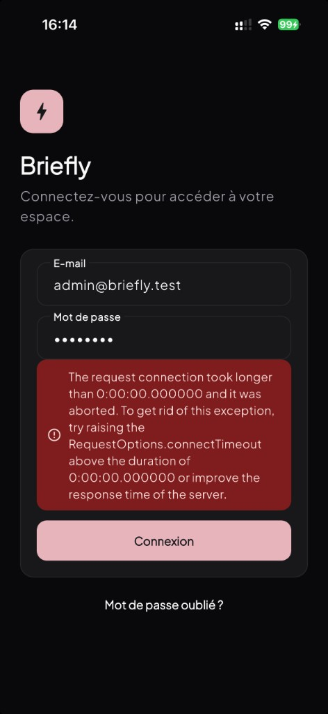
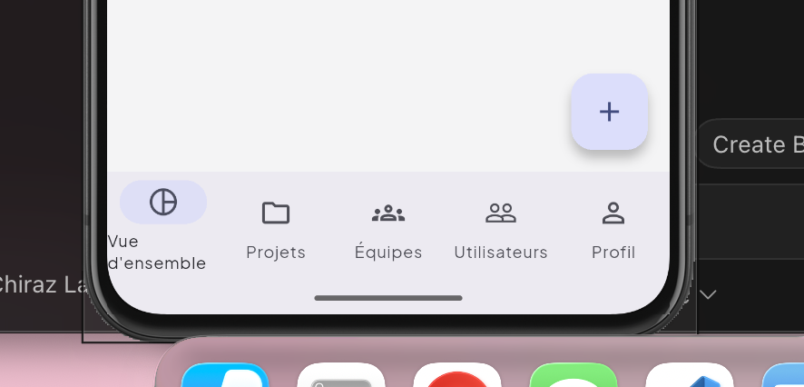

# Du site web Laravel à l’application mobile Flutter

Note de réalisation, licence CDA. Projet Briefly.

## 1. Introduction

Briefly est une application interne de suivi d’avancement. Elle s’adresse à des équipes déjà constituées. L’administrateur crée les comptes. Il n’y a pas d’inscription publique. Les utilisateurs sont administrateur, chef d’équipe ou membre. Un membre dépose des points d’avancement (réalisé, à venir, note de blocage). Le chef d’équipe et l’administrateur lisent ces données dans des tableaux de bord.

Nous avons d’abord construit le site web. Laravel reçoit les requêtes, applique les règles métier, parle à MySQL, puis rend des pages Blade (Bootstrap 5.3). Le navigateur s’authentifie par cookie de session.

Nous avons ensuite ajouté un client mobile Flutter. Il appelle les mêmes URL, avec l’en-tête `Accept: application/json`, et affiche la réponse. Après `POST /login`, Laravel émet un jeton Sanctum. Les appels suivants portent `Authorization: Bearer`.

## 2. Laravel, puis Flutter

Laravel est le serveur d’application. C’est là que vivent le routage (`routes/web.php`), les contrôleurs, les Form Requests, les politiques, les services et les modèles Eloquent. Une création de tâche ou une mise à jour d’avancement est décidée une seule fois, que l’appel vienne d’un formulaire HTML ou d’un JSON.

Flutter est une présentation. Les widgets, GoRouter, Riverpod et Dio reconstituent les écrans. Ils ne recalculent pas les taux d’avancement et ne dérivent pas le rôle. Le téléphone n’ouvre jamais MySQL.

La bascule HTML / JSON se fait dans `Controller::respond()`. Si `expectsJson()` est vrai, le serveur sérialise. Sinon, il renvoie la vue Blade ou la redirection.



## 3. Deux projets, un backend

Le principe est celui de dépôts séparés. Le site est un projet Composer (`composer.json`). L’application mobile est un projet Flutter (`mobile/pubspec.yaml`). Chacun a ses dépendances, son cycle de build et son dépôt Git possible. Ils ne s’échangent pas de PHP ni de Dart. Ils s’accordent sur un contrat HTTP : les mêmes chemins, les mêmes codes, les mêmes ressources JSON.

Dans ce projet de licence, les deux arbres sont dans un seul dépôt Git, le dossier `mobile/` à côté du code Laravel. C’est un choix pratique pour livrer le mémoire. On pourrait extraire `mobile/` vers un second remote sans changer le serveur, tant que les URL restent stables.

Ce que le client mobile n’a pas le droit de faire :

- lire ou écrire MySQL ;
- recopier les règles des politiques (`TaskPolicy`, `ProjectPolicy`) ;
- inventer un rôle ou un pourcentage d’avancement.

Ce qu’il fait : appeler `/login`, `/dashboard`, `/tasks`, `/admin`, etc., puis afficher.

**Figure 1.** Extrait de `routes/web.php` : un seul fichier de routes pour le navigateur et le téléphone.



**Figure 2.** Extrait de `mobile/lib/core/api_client.dart` : Dio cible `ApiConfig.baseUrl`, envoie du JSON, poste `device_name` à la connexion.



## 4. Démarche, étape par étape

### Étape 1. Le site existe et fonctionne

MySQL (XAMPP) contient le schéma `briefly`. Laravel écoute sur le port 8000. Le navigateur ouvre `http://localhost:8000`, est renvoyé vers `/login`, puis, selon le rôle, vers `/dashboard` ou `/admin`.

**Figure 3.** Connexion web.



**Figure 4.** Tableau de bord administrateur, même serveur que le téléphone.



### Étape 2. Rendre le JSON sans dupliquer les routes

Les contrôleurs héritant de `Controller` appellent `respond($request, $html, $json)`. Le middleware `auth:web,sanctum` accepte la session ou le jeton. CSRF est sauté pour un Bearer et pour les `POST` JSON de `/login`, `/forgot-password` et `/reset-password`. `EnsureCanonicalAppUrl` ne redirige pas les requêtes JSON vers `APP_URL`, afin qu’un téléphone qui appelle une IP locale ne soit pas renvoyé sur `localhost`.

### Étape 3. Créer le client Flutter à part

Le projet `mobile/` a son `pubspec.yaml`, ses écrans Dart et sa propre navigation. L’URL du serveur se lit dans `ApiConfig` : `127.0.0.1:8000` sur la machine, `10.0.2.2:8000` pour l’émulateur Android, et une valeur `--dart-define=API_BASE_URL=...` pour un iPhone physique.

### Étape 4. Lancer le backend pour le téléphone

`127.0.0.1` sur l’iPhone désigne le téléphone lui-même. On sert donc Laravel sur toutes les interfaces, puis on passe l’adresse que le téléphone peut joindre.

```bash
php artisan serve --host=0.0.0.0 --port=8000
```

Si le port 8000 est déjà pris, le serveur tourne déjà. Il ne faut pas en démarrer un second.

### Étape 5. Compiler et installer l’application

Dans Visual Studio Code, on ouvre le dossier `mobile/`, on choisit l’iPhone dans la barre d’état, et on lance depuis le terminal :

```bash
cd mobile
flutter run --release --dart-define=API_BASE_URL=http://<IP-DU-MAC>:8000
```

Le mode `--release` permet d’ouvrir l’icône **Briefly Mobile** depuis l’écran d’accueil. Un build debug, sur iOS 14 ou plus, n’est lançable que depuis l’outil Flutter.

**Figure 5.** Terminal : `artisan serve`, puis `flutter run --release` jusqu’à l’installation sur l’iPhone.



### Étape 6. Se connecter avec le même compte

Les identifiants de démonstration sont ceux du seeder (`password` pour tous) : `admin@briefly.test`, `marcus.chen@briefly.test` (chef d’équipe), `emma.nguyen@briefly.test` (membre). Le `POST /login` JSON renvoie `{ token, user }`. L’application stocke le jeton dans `flutter_secure_storage`.

**Figure 6.** Écran de connexion Briefly Mobile sur iPhone. La bannière rouge de cette capture correspond à un essai où le téléphone n’atteignait pas encore Laravel. L’interface, elle, est celle de l’application installée.



**Figure 7.** Barre de navigation une fois authentifié : vue d’ensemble, projets, équipes, utilisateurs, profil. Les libellés reprennent le menu web administrateur.



## 5. Point de vigilance sur le réseau

Le navigateur et le téléphone ne voient pas `localhost` de la même façon. Sur la machine, `http://localhost:8000` suffit. Sur un iPhone, il faut l’adresse IPv4 du Mac, et le téléphone doit pouvoir l’atteindre. Un réseau d’établissement qui isole les clients l’un de l’autre bloque `http://10.x.x.x:8000` même si Laravel répond bien depuis le Mac. Dans ce cas on pointe `API_BASE_URL` vers une origine joignable (données cellulaires, partage de connexion USB, ou tunnel HTTPS vers le `artisan serve` local), puis on réinstalle l’application. Le serveur Laravel, lui, ne change pas.

## 6. Bilan

Le site a fixé le métier. Flutter consomme les mêmes URL. Laravel reste le seul accès à MySQL.
