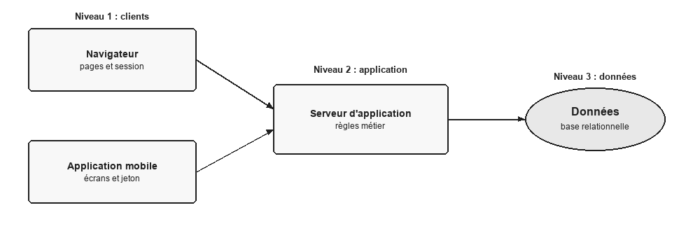
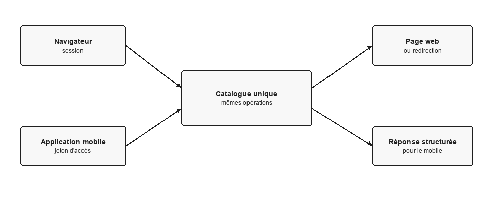
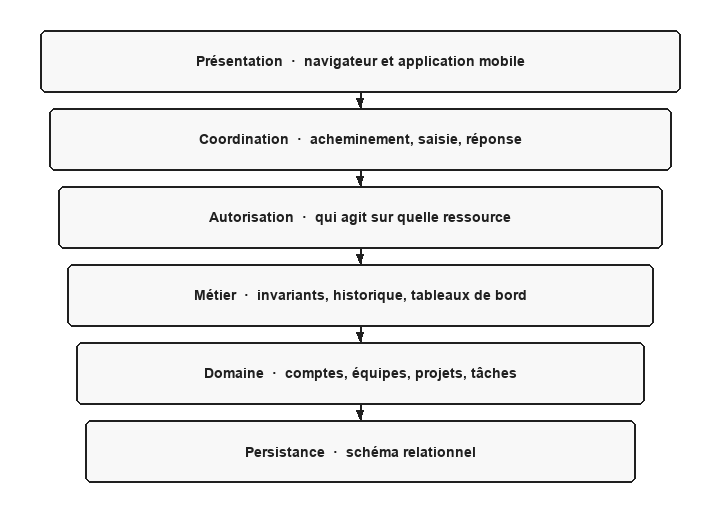
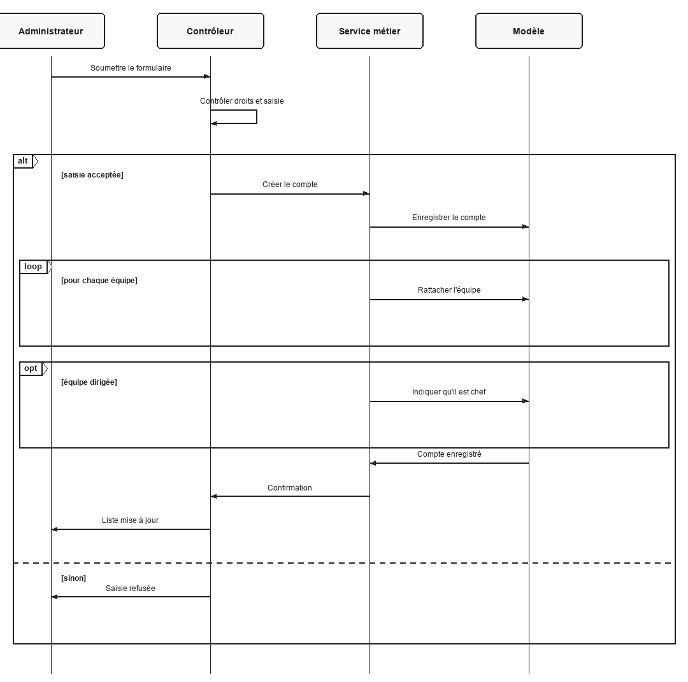
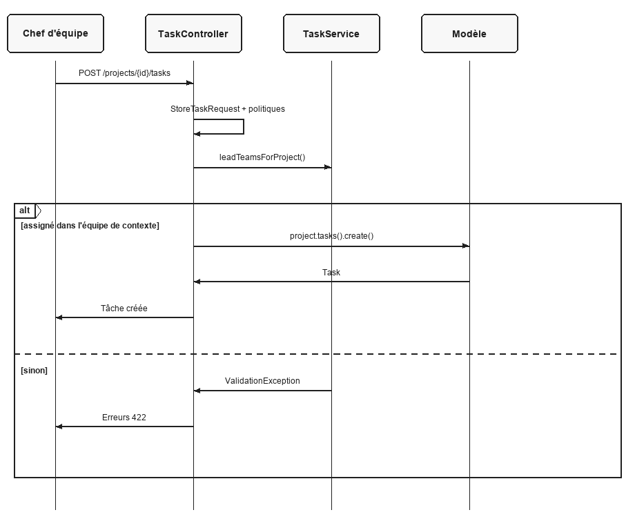
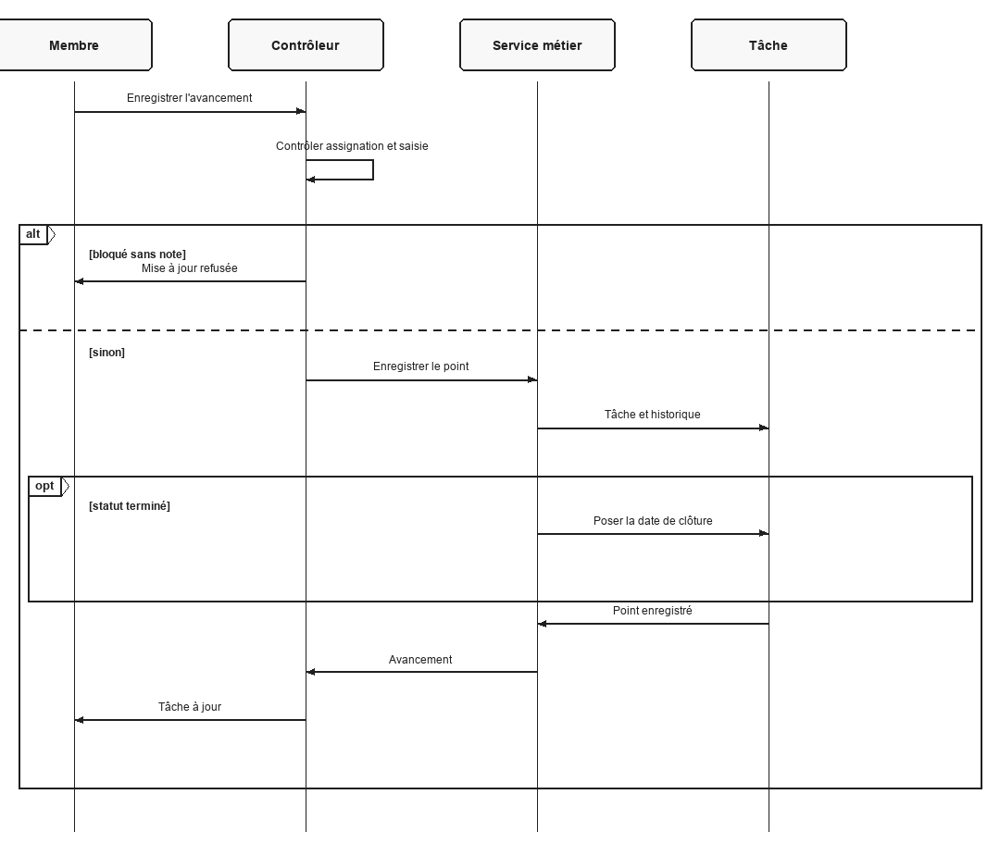
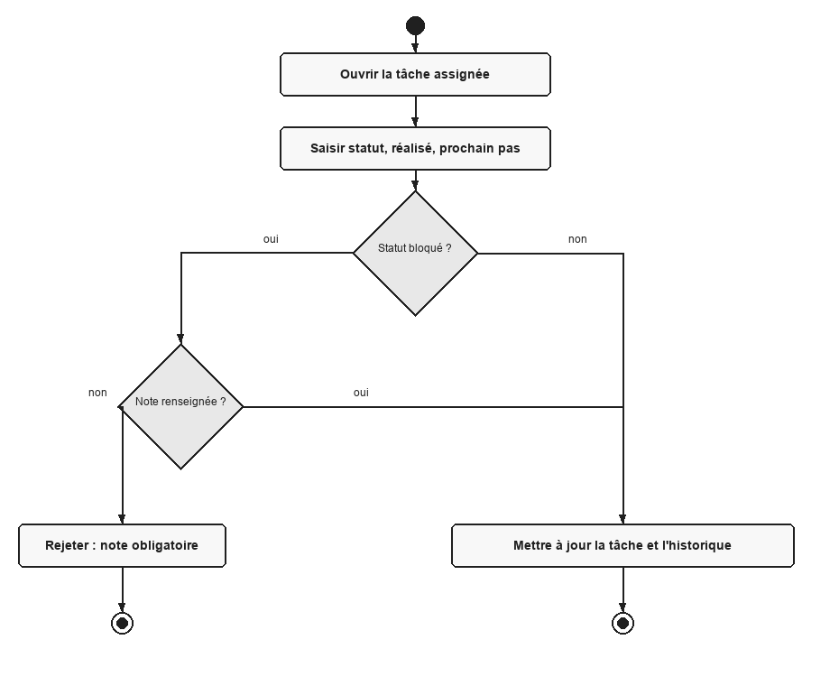
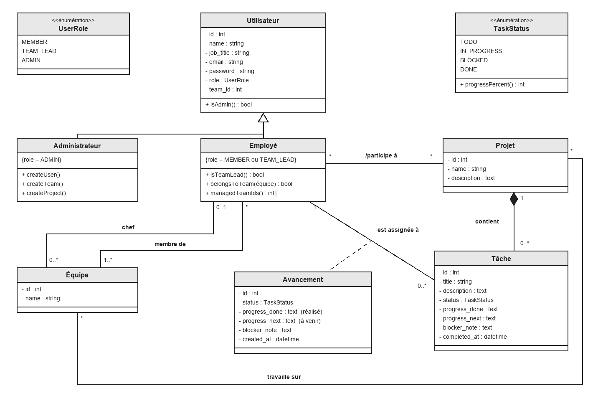
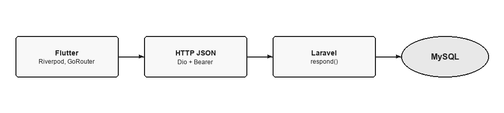

# Chapitre 3 : Conception

## Introduction

Le chapitre 2 a fixé le périmètre fonctionnel de Briefly et les exigences qui en découlent. Nous traduisons ici ces spécifications en une architecture et en des collaborations d’objets assez précises pour orienter la réalisation, du déploiement physique jusqu’aux règles métier encapsulées dans les services et les politiques d’autorisation.

Nous concevons Briefly comme une application interne unique, exposée au navigateur et à l’application Flutter, et servie par un même serveur Laravel. Les règles de validation, d’autorisation et de persistance restent une source de vérité unique, que la requête arrive d’un formulaire Blade ou d’un appel JSON. La conception détaillée formalise cette organisation, d’abord à l’échelle globale (architectures physique et logique), puis à l’échelle des collaborations (séquences, activité, classes) et enfin du client mobile.

La section 3.1 présente l’architecture globale : le déploiement 3-tiers, le protocole de communication unifié et le découpage logique en couches Laravel. La section 3.2 descend au niveau des objets : trois scénarios métier représentatifs, le flux d’activité de mise à jour d’une tâche, le modèle de classes du domaine et le schéma relationnel qui en découle, puis l’architecture du client Flutter.

## 3.1 Conception globale

Cette section pose où s’exécute chaque responsabilité, comment les clients dialoguent avec le serveur, et selon quelles couches le code applicatif est organisé. Les collaborations de la section 3.2 s’appuient sur ces frontières.

### 3.1.1 Architecture physique

Nous retenons une architecture physique **3-tiers**. Les responsabilités de présentation, de traitement et de persistance sont déployées sur des niveaux distincts.

Le **premier niveau** est celui des clients. Deux supports d’interface coexistent : le navigateur, qui affiche les vues Blade produites par Laravel, et l’application mobile Flutter, qui interprète des réponses JSON. Ces deux clients n’embarquent pas le métier. Ils formulent des requêtes HTTP vers le même serveur et en restituent le résultat.

Le **deuxième niveau** est le serveur d’application Laravel. Il accueille le routage, l’authentification, l’autorisation, la validation, les services métier et l’accès aux modèles. C’est à ce niveau que se concentrent les règles que nous ne voulons pas dupliquer.

Le **troisième niveau** est le serveur de données MySQL. Il conserve les utilisateurs, les équipes, les projets, les tâches et l’historique des points d’avancement. Les clients n’y accèdent jamais directement.

{width=15cm}

**Figure 3.1** – Architecture physique de Briefly (déploiement 3-tiers)

Ce découpage se justifie, dans le contexte de Briefly, par trois critères.

**Flexibilité.** Les deux clients évoluent à des rythmes différents : le web s’appuie sur Blade et Bootstrap, le mobile sur des widgets Flutter, GoRouter et Riverpod. En isolant la présentation, nous pouvons enrichir l’un sans republier l’autre, tant que le contrat HTTP demeure stable. Le serveur d’application peut être déployé, mis à l’échelle ou mis à jour indépendamment du schéma de données, dès lors que les migrations Eloquent restent maîtrisées.

**Sécurité.** Les identifiants MySQL, les hachages de mots de passe et les jetons d’accès ne quittent pas le périmètre serveur. Les clients ne voient que ce que les ressources JSON ou les vues Blade exposent. L’autorisation (politiques, middleware de rôle) s’exerce *avant* tout accès aux modèles, ce qui empêche un client, même authentifié, d’outrepasser son rôle en appelant directement la base. L’absence d’auto-inscription, déjà posée au chapitre 2, se traduit par un point d’entrée unique : la création d’utilisateur est une opération d’administration, pas une route publique.

**Performance.** Le serveur d’application concentre les requêtes Eloquent (chargement des relations, statistiques de tableaux de bord, pagination de l’historique) et évite aux clients de multiplier les allers-retours vers MySQL. Le navigateur bénéficie du rendu serveur pour les pages métier. Le mobile ne télécharge que le JSON nécessaire. MySQL reste libre d’être dimensionné (index, moteur InnoDB) sans imposer ces contraintes aux clients.

#### Communication unifiée : un seul fichier de routes, deux représentations

Briefly ne dispose pas d’un fichier de routes API distinct. L’ensemble des URL métier est déclaré dans `routes/web.php`. Les contrôleurs héritant de la classe de base `Controller` s’appuient sur la méthode `respond()` : si la requête `expectsJson()` (en pratique, si l’en-tête `Accept: application/json` est présent), le serveur renvoie du JSON. Sinon, une vue Blade ou une redirection. Selon les endpoints, ce JSON est soit une *Eloquent API Resource*, soit un tableau assemblé à partir de `resolve()` sur ces ressources.

Cette stratégie unifie le contrat d’URL. Une création de tâche, une mise à jour d’avancement ou une consultation de tableau de bord empruntent le même chemin HTTP, que l’acteur soit devant un navigateur ou devant l’application Flutter. Les règles de validation (Form Requests) et d’autorisation (politiques, middleware) s’appliquent une seule fois.

L’authentification se dédouble selon le client, tout en restant branchée sur les mêmes routes protégées par le middleware `auth:web,sanctum` :

- **Web.** L’authentification repose sur la session Laravel. Après un `POST /login` réussi, la session est régénérée et l’utilisateur est redirigé vers le tableau de bord administrateur ou opérationnel selon son rôle.
- **Mobile.** Le même `POST /login`, accompagné d’un champ `device_name` et d’un `Accept: application/json`, provoque la création d’un *personal access token* Sanctum. Les requêtes suivantes portent l’en-tête `Authorization: Bearer`. Un `POST /logout` JSON supprime le jeton courant (`currentAccessToken()->delete()`), invalide éventuellement la session associée, et répond sans contenu.

Les requêtes munies d’un jeton Bearer sont exemptées de la vérification CSRF, ce qui rend le client mobile viable sans cookie de session. Les routes d’authentification JSON (`login`, `forgot-password`, `reset-password`) le sont également, afin que Flutter puisse obtenir un jeton avant toute session.

{width=15cm}

**Figure 3.2** – Communication unifiée entre clients et serveur Laravel

**Tableau 3.1** – Middleware d’accès

| Middleware | Rôle de conception |
|---|---|
| `EnsureCanonicalAppUrl` | Exécuté en premier dans le groupe web. Redirige les requêtes HTML vers l’URL canonique (`APP_URL`). Les requêtes JSON et celles portant un jeton Bearer sont laissées passer, pour ne pas casser le client mobile. |
| `EnsureAdmin` | Filtre de groupe : réserve le préfixe `/admin` aux utilisateurs de rôle `ADMIN`. |
| `EnsureTeamLead` | Filtre de groupe : réserve la création et l’édition de tâches, ainsi que la vue d’équipe, aux chefs d’équipe. |
| `EnsureNotAdmin` | Filtre de groupe : écarte l’administrateur de `/tasks`, `/tasks/history` et de la mise à jour d’avancement (redirection web, 403 JSON). La route `/dashboard` n’est pas couverte. |
| `SetLocale` | Exécuté en dernier dans le groupe web. Fixe la locale (`fr` ou `en`) à partir de la session. Côté mobile, la langue de l’interface est locale à l’appareil et n’appelle pas cette route. |

Ces filtres opèrent au niveau des groupes de routes. Les politiques (`TaskPolicy`, `ProjectPolicy`) affinent ensuite l’autorisation au niveau de la ressource, comme nous le précisons à la sous-section suivante.

### 3.1.2 Architecture logique

Nous projetons Briefly sur les couches que Laravel fournit. Le contrôleur autorise et valide, puis appelle un service ou, pour certaines créations, le modèle. Par exemple, `TaskController::store` persiste via `$project->tasks()->create()`. Les politiques répondent par un booléen. Elles n’appellent pas les services.

Les couches retenues sont les suivantes.

**Présentation.** Côté web, les vues Blade composées avec Bootstrap 5.3 (feuille de styles CDN et CSS applicatif) restituent formulaires, tableaux de bord et listes. Côté mobile, les widgets Flutter jouent le même rôle. Cette couche n’embarque pas de règle d’intégrité : elle collecte une saisie et affiche une réponse.

**Coordination.** Les routes de `web.php`, les middleware cités plus haut, les contrôleurs et les Form Requests (`StoreUserRequest`, `StoreTaskRequest`, `UpdateTaskProgressRequest`, etc.) traitent la requête. Le contrôleur autorise, valide, délègue au service, puis choisit la représentation via `respond()`. Les Form Requests concentrent les contraintes de forme (champs requis, unicité, confirmation de mot de passe, appartenance d’ensembles) avant toute mutation.

**Autorisation.** Les politiques `TaskPolicy` et `ProjectPolicy` expriment *qui* a le droit d’agir sur *quelle* ressource. Exemples structurants : `ProjectPolicy::view` n’accorde l’accès qu’à un chef d’équipe dont une équipe dirigée est liée au projet. `TaskPolicy::create` exige un chef d’équipe disposant d’au moins une équipe gérée. `TaskPolicy::updateStatus` n’autorise la mise à jour d’avancement que si `assigned_to` désigne l’utilisateur courant. Les politiques ne persistent rien. Elles répondent par un booléen que le contrôleur interroge (`authorize()`).

**Application / métier.** Les services encapsulent les invariants qui dépassent une simple persistence : `TaskService` (accessibilité d’un projet à une équipe, appartenance de l’assigné, enregistrement d’un point d’avancement, statistiques), `AdminUserService` (création d’utilisateur, synchronisation des équipes et du rôle), `AdminTeamService` (création et composition des équipes), `AdminService` (vue d’ensemble administrateur). Un service `AdminProjectService` complète ce périmètre pour la création et la liaison des projets aux équipes. Aucun de ces services n’écrit de SQL brut pour le métier courant : ils s’appuient sur les modèles.

**Domaine.** Les modèles Eloquent `User`, `Team`, `TeamUser`, `Project`, `Task` et `TaskUpdate`, ainsi que les énumérations `UserRole` (`MEMBER`, `TEAM_LEAD`, `ADMIN`) et `TaskStatus` (`TODO`, `IN_PROGRESS`, `BLOCKED`, `DONE`), portent l’état et les relations. Le domaine expose des questions utiles (`isAdmin()`, `isTeamLead()`, `belongsToTeam()`, `managedTeamIds()`, `progressPercent()`) sans connaître HTTP.

**Persistance.** Eloquent et MySQL matérialisent le domaine. Les tables, clés étrangères et tables de pivot (`team_user`, `project_team`) relèvent de cette couche. Les jetons Sanctum y sont également stockés (`personal_access_tokens`).

{width=14cm}

**Figure 3.3** – Architecture logique en couches (dépendances descendantes)

Un scénario métier se lit donc de haut en bas (interface, contrôleur, autorisation, service ou modèle, persistance). Les diagrammes de séquence de la section 3.2 suivent cette chaîne. Dans quelques cas, le contrôleur persiste directement, notamment à la création d’une tâche.

## 3.2 Conception détaillée

Nous détaillons les collaborations d’objets pour l’entrée d’un utilisateur dans le système (par l’administrateur), la création d’une tâche par un chef d’équipe, et le point d’avancement saisi par le membre assigné. Suivent le flux d’activité de mise à jour, le diagramme de classes du domaine, puis le client mobile.

### 3.2.1 Partie métier / web

Les trois séquences ci-dessous mettent en scène les mêmes types d’objets : **Acteur**, **Interface**, **Contrôleur**, **Service**, **Modèle**. L’interface désigne indifféremment une vue Blade ou un écran Flutter : le contrôleur, lui, ne voit qu’une requête HTTP.

#### Création d’un utilisateur par l’administrateur

Il n’existe pas de route publique de *signup*. Seul un administrateur authentifié, passé par `EnsureAdmin`, peut créer un compte.

Le Form Request `StoreUserRequest` impose le contrat de saisie :

- `name` : obligatoire.
- `job_title` : optionnel.
- `email` : obligatoire, unique dans `users`.
- `password` : obligatoire, confirmé, longueur minimale de 8 caractères.
- `team_ids` : tableau d’au moins une équipe existante.
- `team_lead_ids` : optionnel, mais **sous-ensemble** de `team_ids`. On ne peut pas nommer chef d’une équipe à laquelle l’utilisateur n’appartient pas.

Le service `AdminUserService.createUser` crée d’abord l’utilisateur avec le rôle `MEMBER` et `team_id` égal au premier identifiant de `team_ids`, puis appelle `syncUserTeams`. Cette seconde étape attache les équipes, pose le pivot `is_team_lead` le cas échéant, et *dérive* le rôle (`TEAM_LEAD` si au moins un drapeau chef est vrai). Les administrateurs ne sont pas créés ni réaffectés par ce formulaire : `updateUser` refuse de réassigner un compte `ADMIN`.

**Pré-conditions.** L’acteur est authentifié et de rôle `ADMIN`. Au moins une équipe existe. L’adresse électronique n’est pas déjà utilisée.

**Scénario nominal.** L’administrateur ouvre le formulaire de création, saisit l’identité, le mot de passe confirmé et les équipes, éventuellement en marquant certaines d’entre elles comme équipes de chefferie, puis soumet. Le contrôleur délègue au service, qui persiste l’utilisateur puis synchronise les appartenances. La réponse est une redirection vers la liste (web) ou un `UserResource` en 201 (JSON).

Le fragment « alt » sépare la saisie acceptée de la saisie refusée (422). Dans le cas accepté, « loop » parcourt chaque `team_id` pour attacher l’utilisateur. « opt » pose `is_team_lead` seulement si l’administrateur a aussi fourni ce `team_id` dans `team_lead_ids`.

**Post-conditions.** Un enregistrement `users` existe, lié à au moins une ligne `team_user`. Le rôle vaut `MEMBER` ou `TEAM_LEAD` selon `team_lead_ids`. Aucun jeton n’est encore émis : le nouvel utilisateur devra s’authentifier.

{width=15cm}

**Figure 3.4** – Diagramme de séquence : création d’un utilisateur par l’administrateur

#### Création d’une tâche par le chef d’équipe

La création d’une tâche s’inscrit dans un *contexte d’équipe*. `ProjectPolicy::view` n’accorde l’accès que si l’une des équipes dirigées par le chef est liée au projet. `TaskPolicy::create` exige en outre qu’il dirige au moins une équipe. Le contrôleur détermine ensuite l’équipe de contexte (`TaskService::leadTeamsForProject`) : la première équipe dirigée liée au projet. Si aucune ne l’est, la requête est refusée (403).

L’équipe de contexte étant par construction liée au projet, un seul invariant métier reste à vérifier dans `TaskService` : `ensureAssigneeOnTeam` impose que l’assigné (`assigned_to`) appartienne à cette même équipe.

Les champs de saisie, validés par `StoreTaskRequest`, sont `title` (obligatoire), `description` (optionnel), `assigned_to` (utilisateur existant) et `status` (valeur de `TaskStatus`).

**Pré-conditions.** L’acteur est authentifié, chef d’équipe (`EnsureTeamLead`), et le projet visé est lié à l’une de ses équipes. L’équipe de contexte compte au moins un membre assignable.

**Scénario nominal.** Le chef ouvre le formulaire de création rattaché au projet, choisit un membre de l’équipe, un titre, un statut initial, éventuellement une description, puis soumet. Après autorisation et validation, le service vérifie le projet et l’assigné. Le modèle `Task` est créé via la relation `project->tasks()`.

Le fragment « alt » sépare le cas où l’assigné appartient à l’équipe de contexte du cas où `ensureAssigneeOnTeam` lève une `ValidationException`.

**Post-conditions.** Une tâche existe, rattachée au projet et à l’assigné. Son statut initial est celui saisi. Aucun `TaskUpdate` n’est encore enregistré : l’historique commence lors du premier point d’avancement.

{width=15cm}

**Figure 3.5** – Diagramme de séquence : le chef d’équipe crée une tâche

#### Mise à jour de l’avancement par le membre assigné

Seul le membre auquel la tâche est assignée peut la mettre à jour : `TaskPolicy::updateStatus` se réduit à l’égalité `assigned_to == user`. Le Form Request `UpdateTaskProgressRequest` s’appuie sur cette politique (`can('updateStatus', $task)`) et impose :

- Un `status` appartenant à `TaskStatus`.
- Des textes optionnels `progress_done` et `progress_next`.
- Un `blocker_note` **obligatoire** lorsque le statut vaut `BLOCKED`.

`TaskService.recordProgress` applique ensuite les effets de bord :

- Mise à jour de la tâche (statut, textes d’avancement, note de blocage).
- Création d’un `TaskUpdate` qui fige le même instantané, afin de conserver l’historique.
- Si le statut est `DONE`, `completed_at` est positionné (conservé s’il existait déjà).
- Si l’on quitte `DONE`, `completed_at` est remis à `null`.
- Si le statut n’est pas `BLOCKED`, `blocker_note` est effacé sur la tâche.

Le pourcentage d’avancement affiché n’est pas saisi : il est *dérivé* du statut par `TaskStatus::progressPercent()` (`TODO` 0 %, `IN_PROGRESS` 60 %, `BLOCKED` 30 %, `DONE` 100 %). Cette convention évite un second champ contradictoire avec le statut.

**Pré-conditions.** L’acteur est authentifié, n’est pas administrateur (`EnsureNotAdmin`), et la tâche lui est assignée.

**Scénario nominal.** Le membre ouvre la tâche, choisit un statut, renseigne le réalisé et le prochain pas, ajoute une note de blocage si nécessaire, puis enregistre. Le service met à jour la tâche et insère un `TaskUpdate`.

Le fragment « alt » refuse la requête lorsque le statut est `BLOCKED` et que la note est absente. Dans l’autre opérande, « opt » pose `completed_at` seulement si le statut retenu est `DONE`.

**Post-conditions.** La tâche reflète le nouveau statut et les textes d’avancement. Un enregistrement `task_updates` relie la tâche et l’utilisateur. `completed_at` est cohérent avec `DONE`. Le pourcentage dérivé correspond au statut.

{width=15cm}

**Figure 3.6** – Diagramme de séquence : le membre met à jour l’avancement

#### Diagramme d’activité : mettre à jour une tâche

Le diagramme de séquence décrit les objets. Le diagramme d’activité isole la décision qui structure le métier d’avancement. Si le statut choisi est `BLOCKED`, le système exige une note de blocage. Sans cette note, la mise à jour est rejetée. Pour tout autre statut, ou lorsque la note est présente, le système met à jour la tâche et crée un `TaskUpdate`. Le champ `completed_at` est posé à l’entrée dans `DONE` et remis à vide lorsqu’on en sort.

{width=14cm}

**Figure 3.7** – Diagramme d’activité : mise à jour d’une tâche

Cette activité est la même côté web et côté mobile. Le client Flutter peut anticiper le rejet (`isMissingBlockerNote`) pour l’ergonomie, mais le Form Request serveur demeure la source de vérité : une requête JSON qui omettrait la note serait refusée au même titre qu’un formulaire Blade incomplet.

#### Diagramme de classes

La figure 3.8 modélise le domaine Briefly. La classe `Utilisateur` regroupe ce que tous les comptes partagent : identité, adresse électronique, mot de passe haché et rôle. Deux classes en héritent. `Administrateur` gère les comptes, les équipes et les projets. `Employé` désigne un membre ou un chef d’équipe, c’est-à-dire tout compte qui reçoit des tâches.

Un employé est lié aux équipes par deux associations. L’association « membre de » indique qu’un employé appartient à au moins une équipe, condition imposée par `StoreUserRequest`. L’association « chef » indique qu’une équipe a au plus un chef. `AdminUserService` retire en effet l’ancien drapeau chef d’une équipe avant d’en poser un nouveau. Une équipe travaille sur plusieurs projets, et un projet peut être partagé entre plusieurs équipes ou n’en avoir encore aucune.

Un projet contient ses tâches. Nous représentons ce lien par une composition, car la suppression d’un projet supprime ses tâches en cascade. Une tâche est assignée à un seul employé, ce qui permet à `TaskPolicy::updateStatus` de décider sans ambiguïté qui peut la mettre à jour. La classe d’association `Avancement` est attachée à ce lien. Elle décrit un point d’avancement saisi par l’employé sur sa tâche : statut, travail réalisé, travail à venir, note de blocage et date. Un employé saisit plusieurs points sur la même tâche au fil du temps. La date distingue donc les avancements successifs d’un même couple employé et tâche.

L’association « /participe à » entre `Employé` et `Projet` est une association dérivée, signalée par la barre oblique. Aucune table ne la stocke. Elle se calcule à partir des équipes de l’employé et des projets liés à ces équipes, comme le fait `ProjectPolicy::view` pour un chef d’équipe.

{width=16cm}

**Figure 3.8** – Diagramme de classes du domaine Briefly

**Tableau 3.2** – Détails des classes du domaine

| Classe | Rôle dans la conception |
|---|---|
| `Utilisateur` | Compte interne : identité, intitulé de poste, adresse électronique unique, mot de passe haché, rôle et équipe primaire (`team_id`). Correspond au modèle `User`. La méthode `isAdmin()` est utilisée par le middleware `EnsureAdmin`. |
| `Administrateur` | Utilisateur de rôle `ADMIN`. Il crée les comptes, les équipes et les projets par l’intermédiaire de `AdminUserService`, `AdminTeamService` et `AdminProjectService`. Il ne reçoit pas de tâche. |
| `Employé` | Utilisateur de rôle `MEMBER` ou `TEAM_LEAD`. Les méthodes `isTeamLead()`, `belongsToTeam()` et `managedTeamIds()` sont lues par les politiques et par `TaskService`. Le rôle `TEAM_LEAD` est dérivé de l’association « chef ». |
| `Équipe` | Regroupe des employés et des projets. C’est l’équipe de contexte qui encadre la création d’une tâche et le tableau de bord du chef. |
| `Projet` | Regroupe les tâches. Un chef n’y accède que si l’une des équipes qu’il dirige y est liée. |
| `Tâche` | Unité de travail : titre, description, statut, textes d’avancement, note de blocage et date de clôture. Elle appartient à un projet et à un employé assigné. |
| `Avancement` | Classe d’association entre l’employé et sa tâche. Chaque saisie fige le statut et les textes au moment de la mise à jour, ce qui conserve l’historique complet. Correspond au modèle `TaskUpdate`. |
| `UserRole` | Énumération des rôles (`MEMBER`, `TEAM_LEAD`, `ADMIN`). Elle sert de discriminant entre `Administrateur` et `Employé`. |
| `TaskStatus` | Énumération du cycle de vie (`TODO`, `IN_PROGRESS`, `BLOCKED`, `DONE`). Sa méthode `progressPercent()` donne le pourcentage affiché (0, 60, 30 et 100 %). |

#### Schéma relationnel

Le passage du diagramme de classes au modèle relationnel suit les règles habituelles. Chaque classe du domaine devient une table, et son identifiant une clé primaire `id`. Une association 1-N place la clé de la classe côté 1 dans la table côté N, sous forme de clé étrangère : `tasks.project_id`, `tasks.assigned_to`, `task_updates.task_id` et `task_updates.user_id`. Une association N-N devient une table de pivot dont la clé primaire réunit les deux clés étrangères : c’est le cas de `team_user` et de `project_team`. Les énumérations `UserRole` et `TaskStatus` sont stockées en chaînes de caractères dans `users.role`, `tasks.status` et `task_updates.status`.

Quatre éléments du diagramme demandent une règle particulière. L’héritage est ramené à une table unique : `Utilisateur`, `Administrateur` et `Employé` partagent la table `users`, et la colonne `role` indique la sous-classe. Les associations « membre de » et « chef » sont réunies dans le pivot `team_user`, où le booléen `is_team_lead` désigne le chef. La classe d’association `Avancement` devient la table `task_updates`. Elle reçoit son propre `id`, puisqu’un même couple employé et tâche peut avoir plusieurs avancements. Enfin, l’association dérivée « /participe à » ne produit aucune table.

Les migrations de `database/migrations` créent ce schéma dans MySQL. Le tableau 3.3 en donne la forme finale. Les clés primaires sont soulignées et les clés étrangères précédées de `#`. Les colonnes `created_at` et `updated_at`, présentes dans chaque table sauf `project_team`, sont omises.

**Tableau 3.3** – Schéma relationnel de la base `briefly`

| Table | Colonnes | Contraintes |
| --- | --- | --- |
| `users` | [id]{.underline}, name, job_title, email, password, role, #team_id, remember_token, email_verified_at | `email` unique. `team_id` désigne l’équipe primaire et passe à `NULL` si l’équipe est supprimée |
| `teams` | [id]{.underline}, name | Aucune |
| `team_user` | [#team_id, #user_id]{.underline}, is_team_lead | Suppression en cascade avec l’équipe ou l’utilisateur |
| `projects` | [id]{.underline}, name, description | Aucune |
| `project_team` | [#project_id, #team_id]{.underline} | Suppression en cascade avec le projet ou l’équipe |
| `tasks` | [id]{.underline}, #project_id, #assigned_to, title, description, status, progress_done, progress_next, blocker_note, completed_at | `assigned_to` référence `users.id`. Suppression en cascade avec le projet ou l’assigné |
| `task_updates` | [id]{.underline}, #task_id, #user_id, status, progress_done, progress_next, blocker_note | Suppression en cascade avec la tâche ou l’auteur |
| `personal_access_tokens` | [id]{.underline}, tokenable_type, tokenable_id, name, token, abilities, last_used_at, expires_at | `token` unique. Association polymorphe de Sanctum vers `users` |

Laravel ajoute ses tables techniques : `sessions` pour la session web, `password_reset_tokens` pour la réinitialisation du mot de passe et `cache`. Elles ne portent pas de donnée métier.

### 3.2.2 Partie mobile

Le client Flutter est une présentation alternative du même serveur. Il consomme les URL de `web.php`, avec `Accept: application/json`, et interprète les *API Resources* déjà conçues pour le web JSON.

Les choix de conception du client sont les suivants.

- **HTTP.** La bibliothèque Dio centralise les appels. Chaque requête porte `Accept: application/json` et, une fois l’utilisateur authentifié, `Authorization: Bearer`. Le `POST /login` envoie `device_name` (valeur `flutter`) afin que Sanctum nomme le jeton.
- **Stockage du secret.** Le jeton est confié à `flutter_secure_storage`, hors du stockage en clair de l’application. La déconnexion locale l’efface, après un `POST /logout` qui supprime le jeton côté serveur.
- **État.** Riverpod gère l’authentification, la locale et le thème, et fournit le client HTTP aux écrans. GoRouter renvoie un visiteur non authentifié vers `/login`. Un administrateur authentifié est redirigé de `/dashboard` et `/tasks` vers `/admin`. Les autres routes membre ou chef d’équipe s’appuient sur le refus 403 du serveur.
- **Internationalisation et thème.** Les catalogues l10n français et anglais, ainsi que les thèmes clair et sombre, relèvent de la présentation mobile (`shared_preferences`). Ils ne changent pas la locale de session Laravel.
- **Validation locale.** La validation du `blocker_note` existe bien côté client, pour afficher une erreur avant l’aller-retour réseau. Elle est un confort d’interface : le serveur reste l’autorité, via `UpdateTaskProgressRequest` et `TaskService.recordProgress`. Les pourcentages d’avancement et la dérivation du rôle ne sont pas recalculés selon une logique mobile distincte.

{width=15cm}

**Figure 3.9** – Chaîne de communication du client Flutter

Le téléphone n’accède jamais à MySQL. Il dialogue en HTTP avec le même serveur d’application que le navigateur. Les trois scénarios de la sous-section 3.2.1 s’appliquent donc sans transcription parallèle des règles.

## Conclusion

Le métier s’exécute sur le serveur Laravel. Le navigateur et l’application Flutter envoient des requêtes HTTP. Ils n’ouvrent pas MySQL. Laravel concentre le routage, l’authentification, les politiques, les services et Eloquent. La méthode `respond()` renvoie du HTML ou du JSON selon l’en-tête `Accept`, à partir du même fichier `routes/web.php`.

Les séquences de création d’utilisateur, de création de tâche et de mise à jour d’avancement, le diagramme d’activité et le modèle de classes placent les règles déjà spécifiées : middleware `EnsureNotAdmin`, politique `updateStatus`, note de blocage obligatoire, service `TaskService.recordProgress`. Le mobile valide les champs pour le confort de saisie. Le serveur reste l’autorité. Les règles ne sont pas recopiées dans Dart.
