# Chapitre 4 : Réalisation

## Introduction

Les chapitres précédents ont fixé le besoin, le périmètre et la conception de Briefly. Nous décrivons ici la mise en œuvre : l’environnement de travail, les outils et les technologies, puis les itérations qui ont produit l’application web Laravel et le client mobile Flutter.

Pour chaque sprint, nous indiquons l’objectif, les écrans réalisés et, le cas échéant, un jeu de tests fonctionnels couverts par PHPUnit. L’architecture en couches figure au chapitre 3, le catalogue des cas d’utilisation au chapitre 2. Le sprint 5 consolide tests, sécurité (§4.3) et intégration continue (§4.4). Le sprint 6 livre le client Flutter.

## 4.1 Environnement du travail

### 4.1.1 Configuration matérielle

Nous avons développé Briefly en 2026 sur un MacBook Air M1.

**Tableau 4.1** – Configuration matérielle

| Poste | Type | Processeur | Mémoire | Stockage | Système d’exploitation |
| --- | --- | --- | --- | --- | --- |
| Poste de développement | MacBook Air (M1) | Apple M1, 8 cœurs | 8 Go | SSD 245 Go (APFS) | macOS 26.5.2 (Darwin 25.5.0) |

### 4.1.2 Configuration logicielle

#### Outils

Le tableau 4.2 indique les outils utilisés pour rédiger le code, servir la base de données locale, préparer les diagrammes de conception et compiler le client iOS.

**Tableau 4.2** – Outils de développement

| Outil | Rôle dans le projet |
| --- | --- |
| Visual Studio Code | Édition du code Laravel (PHP, Blade, CSS) et Flutter (Dart) |
| XAMPP (MySQL) | Serveur de base de données local pour l’application web. Le schéma `briefly` est créé puis migré par Artisan |
| diagrams.net | Élaboration des diagrammes présentés au chapitre de conception |
| Flutter SDK (Dart 3.13) | Compilation et exécution du client mobile |
| Xcode | Signature, simulation et déploiement iOS du projet `mobile/` |

Les tests automatisés PHPUnit s’exécutent sur une base SQLite en mémoire. Ils ne dépendent pas de l’instance MySQL de XAMPP.

#### Technologies

Le socle web repose sur PHP 8.5.5 et Laravel 13. Les vues sont rendues en Blade. L’interface web visible utilise Bootstrap 5.3 et Bootstrap Icons (CDN), plus une feuille de styles applicative. Les graphiques d’administration s’appuient sur Chart.js (CDN). Aucune compilation front n’est nécessaire. L’authentification de session (navigateur) et l’authentification par jeton (application mobile) s’appuient sur Laravel Sanctum. Les tests d’acceptation HTTP sont écrits avec PHPUnit 12. Les données métier sont persistées dans MySQL.

Le client mobile est une application Flutter (SDK Dart 3.13). L’état applicatif est géré avec Riverpod, la navigation avec GoRouter, les appels HTTP avec Dio. Le jeton Sanctum est stocké dans `flutter_secure_storage`. Les graphiques d’administration utilisent `fl_chart`. La typographie s’appuie sur `google_fonts`. L’interface est bilingue (français / anglais) grâce à `intl` et `flutter_localizations`.

Un même jeu de contrôleurs dessert le navigateur et le mobile (§3.1.1). La figure 4.1 montre la mise en œuvre de `respond()`. Lorsque le client envoie `Accept: application/json` (cas du mobile via Dio), la réponse est sérialisée. Sinon, l’utilisateur web reçoit la page Blade ou la redirection prévue.

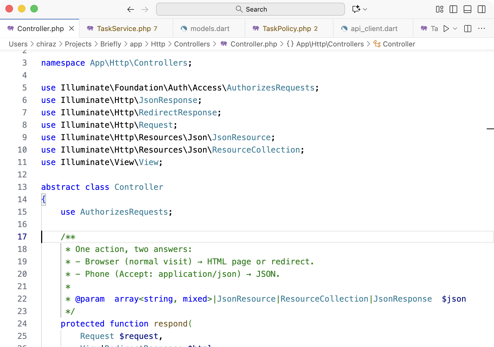{width=15cm}

**Figure 4.1** – Méthode `respond()` (`app/Http/Controllers/Controller.php`)

`TaskService::recordProgress` enregistre un point d’avancement. La méthode met à jour le statut de la tâche, y compris la date de clôture lorsque le statut passe à « terminé », et crée une entrée d’historique `TaskUpdate`. Le mobile et le web empruntent ce même service.

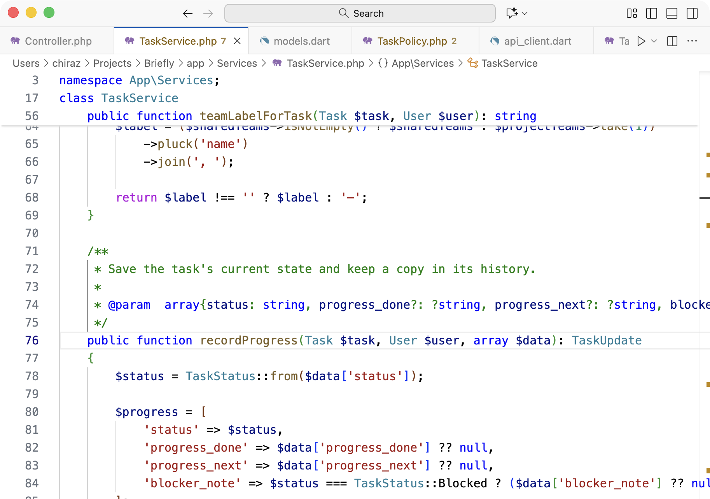{width=15cm}

**Figure 4.2** – Méthode `recordProgress()` (`app/Services/TaskService.php`)

La politique `TaskPolicy::updateStatus` limite la mise à jour d’avancement à l’assigné. Le client Flutter n’a pas à réimplémenter cette règle : il appelle `POST /login` avec `device_name` égal à `flutter`, puis envoie le jeton.

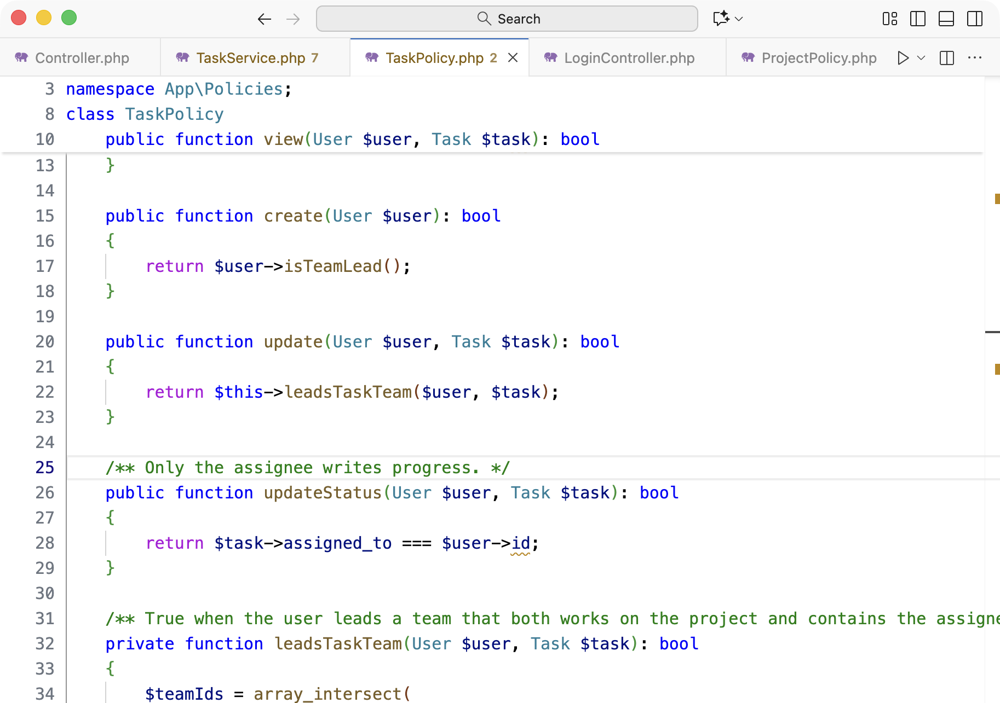{width=15cm}

**Figure 4.3** – Politique `updateStatus` (`app/Policies/TaskPolicy.php`)

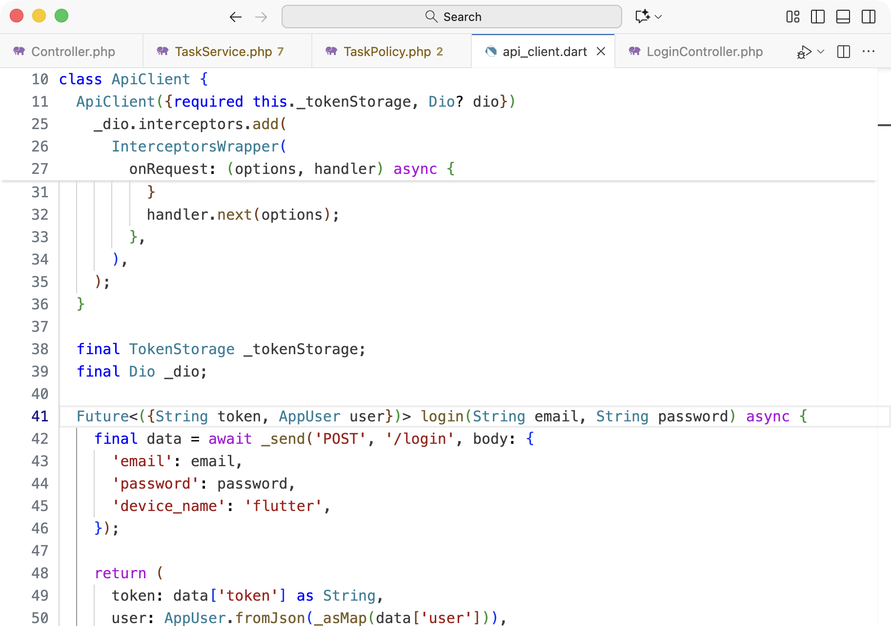{width=15cm}

**Figure 4.4** – Connexion JSON du client Flutter (`mobile/lib/core/api_client.dart`)

Le pourcentage affiché sur les tableaux de bord n’est pas un champ saisi. `TaskStatus::progressPercent()` le dérive du statut : 0 % à faire, 60 % en cours, 30 % bloqué, 100 % terminé.

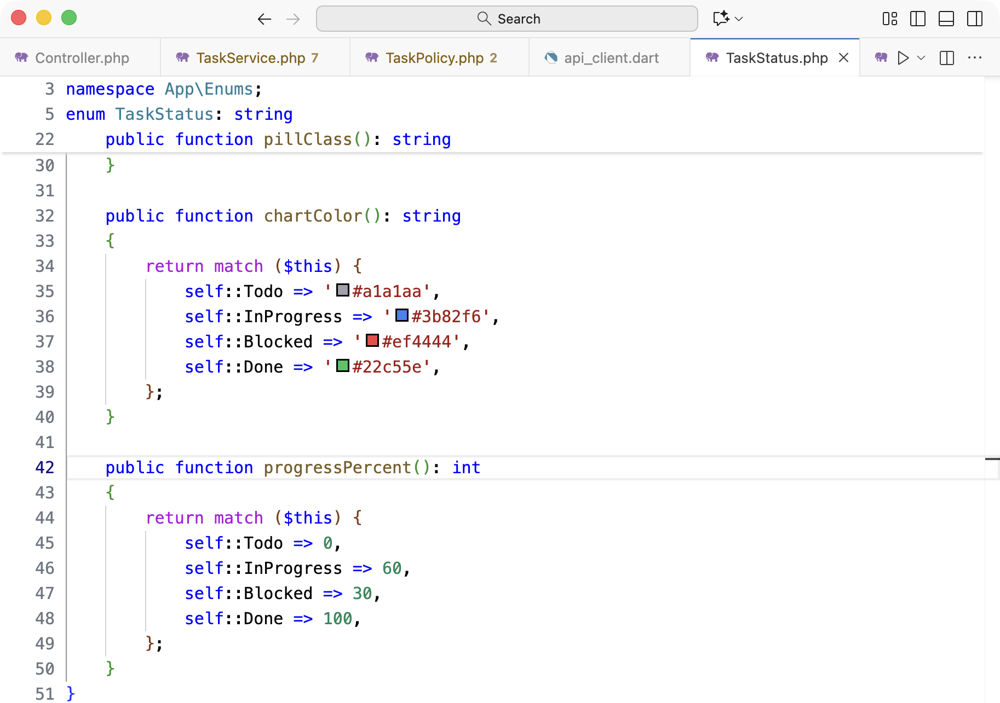{width=15cm}

**Figure 4.5** – Pourcentage d’avancement dérivé du statut (`app/Enums/TaskStatus.php`)

Un compte employé ne peut pas être créé sans équipe. `StoreUserRequest` impose `team_ids` avec au moins un identifiant. C’est la règle qui justifie le « include » de la figure 2.2.

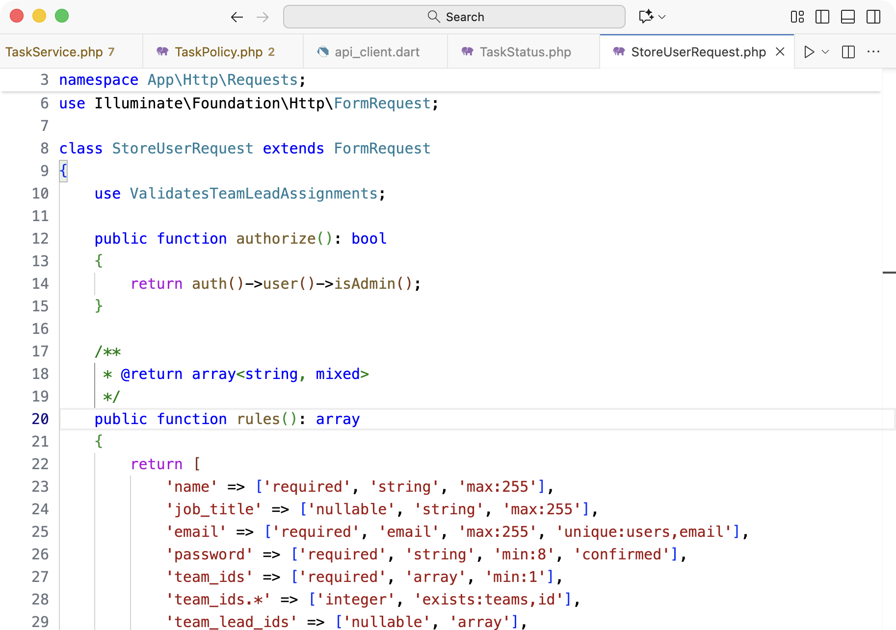{width=15cm}

**Figure 4.6** – Validation de la création d’un utilisateur (`app/Http/Requests/StoreUserRequest.php`)

La note de blocage n’est exigée que si le statut vaut `BLOCKED`. `Rule::requiredIf` porte cette condition. C’est la règle qui justifie le « extend » de la figure 2.4.

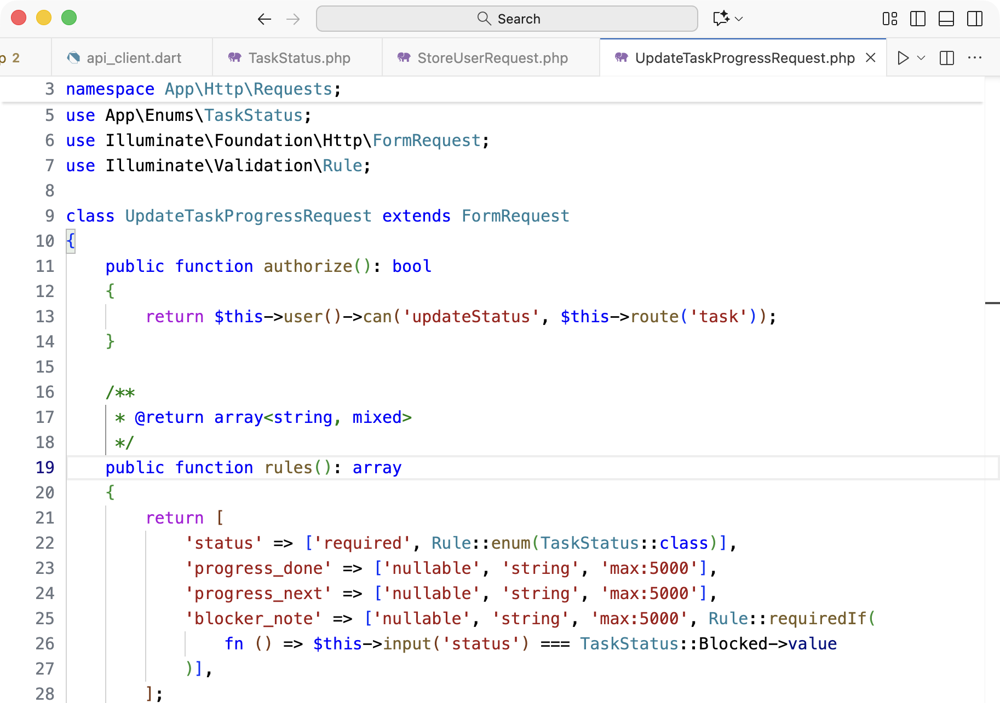{width=15cm}

**Figure 4.7** – Note de blocage obligatoire si le statut est `BLOCKED` (`app/Http/Requests/UpdateTaskProgressRequest.php`)

**Tableau 4.3** – Principales technologies

| Couche | Technologies |
| --- | --- |
| Serveur web | PHP 8.5.5, Laravel 13, Blade, Bootstrap 5.3, Chart.js, Laravel Sanctum, PHPUnit 12 |
| Données | MySQL |
| Client mobile | Flutter (Dart 3.13), Riverpod, GoRouter, Dio, flutter_secure_storage, fl_chart, google_fonts, intl / flutter_localizations |

## 4.2 Réalisation des sprints

Nous avons découpé le travail en six sprints, selon le tableau 2.1. Les tableaux de tests qui suivent transposent, en scénarios fonctionnels, les cas réellement exercés par PHPUnit (`AuthenticationTest`, `AdminTest`, `ProjectTaskTest`, `JsonEndpointTest`, `LocaleTest`). La colonne « Résultat » indique la conformité constatée lors de l’exécution de la suite. Les parcours de réinitialisation du mot de passe, de mise à jour du profil, de l’option « se souvenir de moi » et du thème sont implémentés mais **non couverts** par cette suite.

### Sprint 1 : Authentification, profil, préférences

Un visiteur atteint `/login`. Après authentification, un administrateur est envoyé vers `/admin`. Un membre ou un chef d’équipe rejoint `/dashboard`.

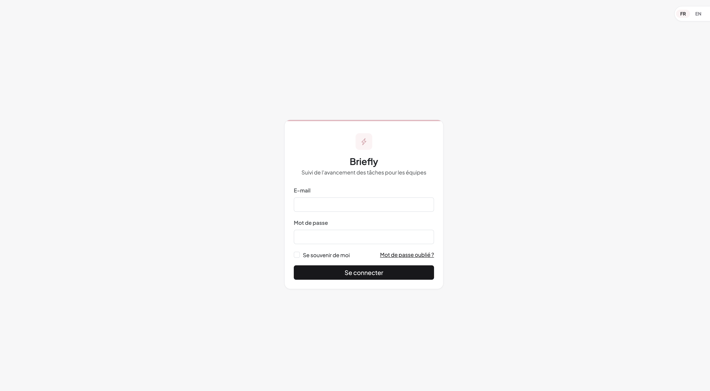{width=14cm}

**Figure 4.8** – Page de connexion web (`/login`)

Le formulaire de demande de lien de réinitialisation n’exige que l’adresse du compte. La page suivante, atteinte depuis le courriel, permet de saisir le nouveau mot de passe à l’aide du jeton.

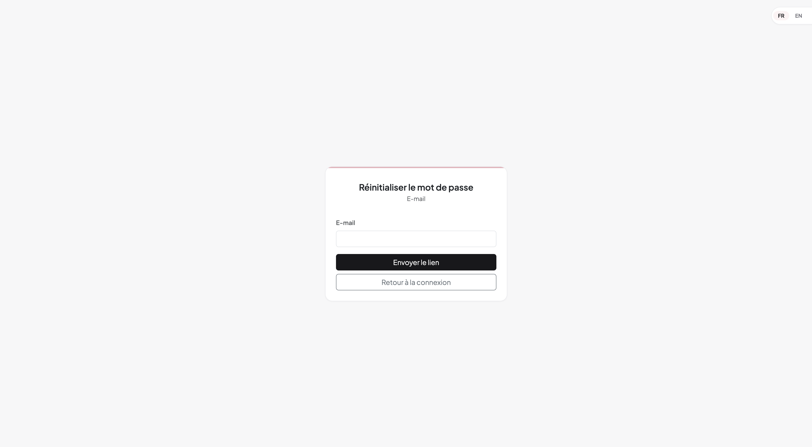{width=14cm}

**Figure 4.9** – Demande de réinitialisation du mot de passe (`/forgot-password`)

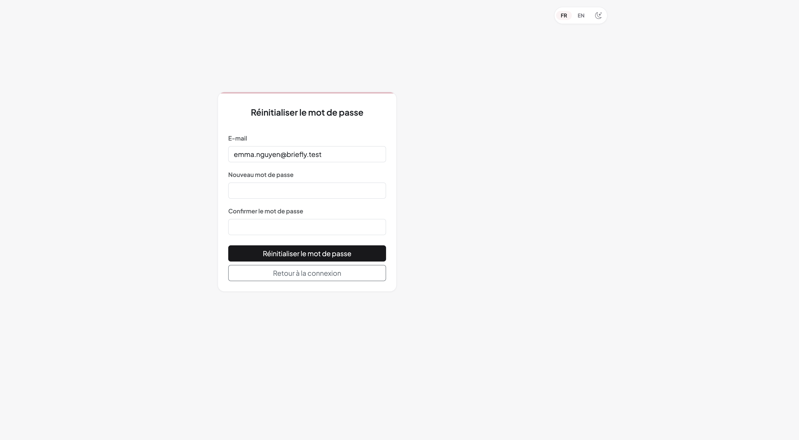{width=14cm}

**Figure 4.10** – Saisie du nouveau mot de passe (`/reset-password/{token}`)

Le profil rassemble deux formulaires. L’un porte sur l’identité (nom, courriel), l’autre sur le changement de mot de passe (mot de passe actuel, nouveau mot de passe, confirmation). L’utilisateur y met à jour le nom et le courriel. L’intitulé de poste reste réservé à l’administration. Le rôle et l’équipe principale y sont affichés, sans pouvoir être modifiés par l’utilisateur.

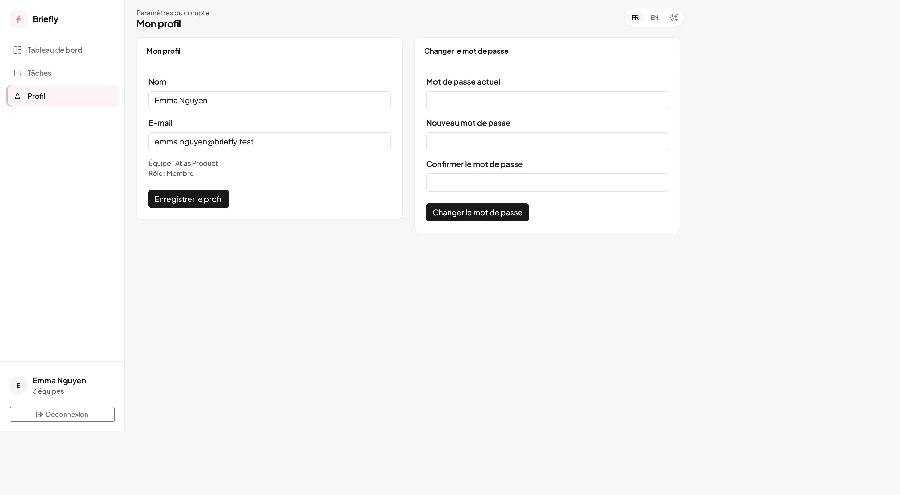{width=14cm}

**Figure 4.11** – Profil et changement de mot de passe (`/profile`)

La barre de préférences (langue FR/EN et bascule de thème) est visible sur toutes les pages, y compris la connexion et la récupération du mot de passe.

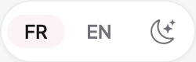{width=14cm}

**Figure 4.12** – Sélecteur de langue et bascule de thème (`briefly-theme`)

**Tableau 4.4** – Tests fonctionnels du sprint 1

| Cas de test | Démarche | Comportement attendu | Résultat |
| --- | --- | --- | --- |
| Affichage de la connexion | Ouvrir `/login` sans session | La page s’affiche | Conforme |
| Connexion membre | Saisir un courriel et un mot de passe valides d’un membre | Redirection vers `/dashboard`. Session authentifiée | Conforme |
| Connexion administrateur | Saisir les identifiants d’un administrateur | Redirection vers `/admin` | Conforme |
| Accès refusé au visiteur | Ouvrir `/dashboard` sans être connecté | Redirection vers `/login` | Conforme |
| Identifiants JSON invalides | Poster `/login` en JSON avec un mot de passe erroné | Réponse 422. Message d’erreur sur le courriel | Conforme |
| Connexion JSON | Poster `/login` en JSON avec `device_name` | Réponse 200 contenant `token` et `user` | Conforme |
| Langue française | Appeler `/locale/fr` puis ouvrir la connexion | Session `locale=fr`. Libellé « Se connecter » | Conforme |
| Langue anglaise | Depuis une session française, appeler `/locale/en` | Session `locale=en`. Libellé « Sign in » | Conforme |
| Locale invalide | Appeler `/locale/de` | Réponse 404 | Conforme |

### Sprint 2 : Espace membre

Le tableau de bord `/dashboard` affiche un indicateur de taux d’avancement personnel et la liste des tâches assignées.

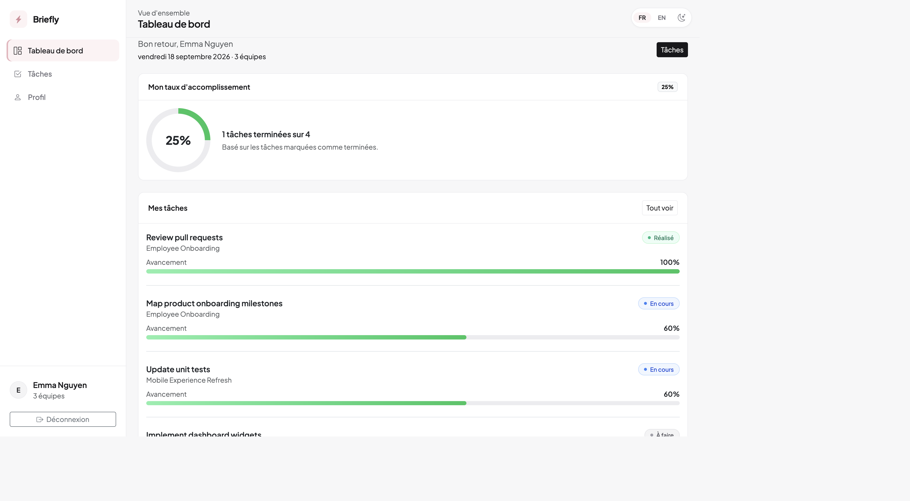{width=14cm}

**Figure 4.13** – Tableau de bord membre : anneau d’avancement et tâches personnelles (`/dashboard`)

La liste `/tasks` présente les tâches assignées, triées et regroupées selon le statut (bloqué, en cours, à faire, terminé), avec le projet, l’équipe et la date de mise à jour. Un raccourci mène à l’historique.

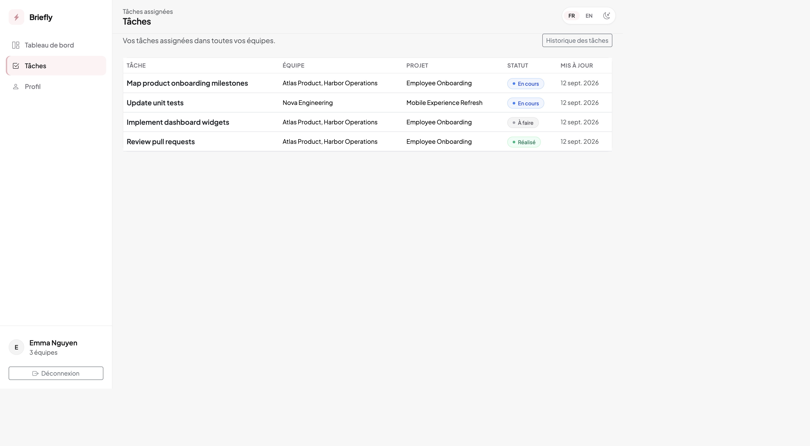{width=14cm}

**Figure 4.14** – Liste des tâches personnelles (`/tasks`)

Le détail d’une tâche assignée propose le formulaire de progression du §2.1.2. Un membre ne peut pas modifier la tâche d’un collègue.

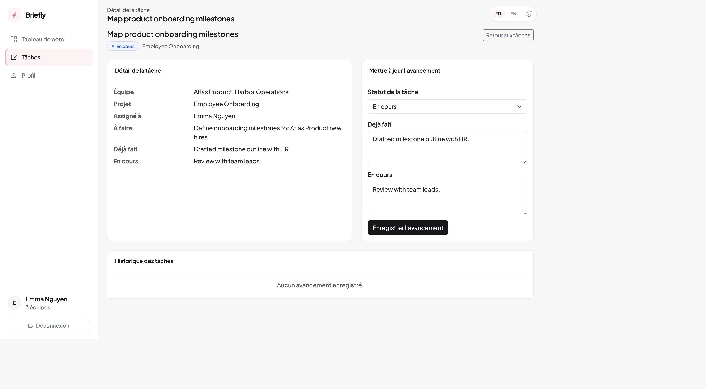{width=14cm}

**Figure 4.15** – Détail d’une tâche et formulaire d’avancement (`/tasks/{id}`)

L’historique paginé des points d’avancement se trouve sur `/tasks/history`. Toute tentative d’accès à `/projects` est refusée.

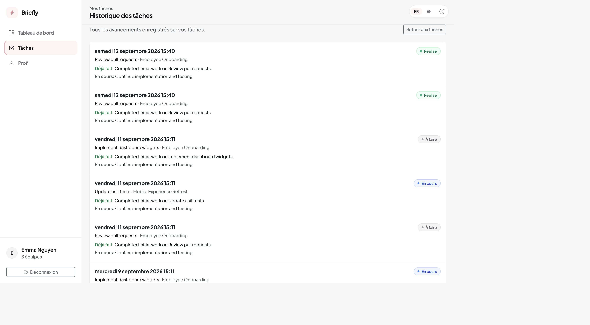{width=14cm}

**Figure 4.16** – Historique des points d’avancement (`/tasks/history`)

**Tableau 4.5** – Tests fonctionnels du sprint 2

| Cas de test | Démarche | Comportement attendu | Résultat |
| --- | --- | --- | --- |
| Tableau de bord membre | Se connecter en membre et ouvrir `/dashboard` | Affichage du taux d’avancement et des tâches personnelles | Conforme |
| Liste des tâches | Ouvrir `/tasks` en tant que membre assigné | Les titres et projets des tâches assignées sont visibles | Conforme |
| Détail et formulaire | Ouvrir `/tasks/{id}` pour une tâche assignée | La page s’affiche avec le formulaire « Mettre à jour l’avancement » | Conforme |
| Enregistrement d’un avancement | Envoyer un statut « en cours » avec le réalisé et le suivant | Redirection vers le détail. Tâche et `task_updates` mis à jour | Conforme |
| Blocage sans note | Passer au statut « bloqué » sans `blocker_note` | Erreur de validation sur la note de blocage | Conforme |
| Marquer terminé | Passer au statut « terminé » | Statut `DONE` et `completed_at` renseigné | Conforme |
| Tâche d’un tiers | Tenter de mettre à jour une tâche assignée à un autre membre | Réponse 403 | Conforme |
| Historique | Enregistrer un avancement puis ouvrir `/tasks/history` | Le titre et le texte de progression apparaissent | Conforme |
| Plusieurs mises à jour | Enregistrer deux avancements successifs sur la même tâche | Deux lignes dans `task_updates` | Conforme |
| Accès projets refusé | Ouvrir `/projects` en tant que membre | Réponse 403 | Conforme |

### Sprint 3 : Espace chef d’équipe

Sur le web, les cartes d’équipe affichent le total, les tâches en cours, les bloquées et les terminées dans la semaine, plus le taux d’avancement et les dernières tâches bloquées.

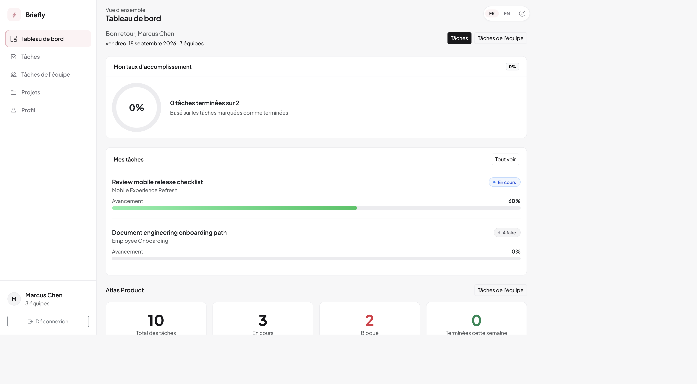{width=14cm}

**Figure 4.17** – Tableau de bord chef d’équipe : cartes des équipes dirigées (`/dashboard`)

La liste des projets montre les projets rattachés aux équipes dirigées, y compris lorsqu’un projet est partagé entre plusieurs équipes. Le chef d’équipe ne crée pas de projets. Le détail d’un projet liste les tâches de l’équipe et permet d’en créer une, assignée exclusivement à un membre de cette équipe. Le chef peut aussi modifier une tâche existante.

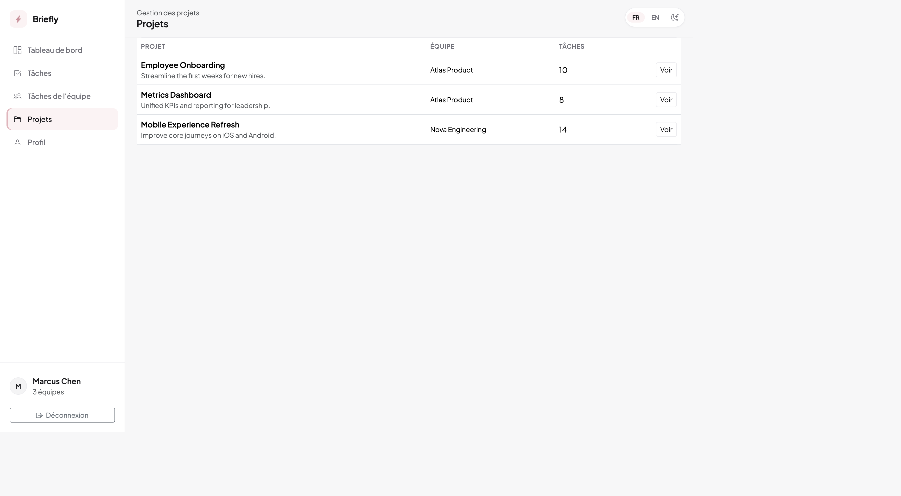{width=14cm}

**Figure 4.18** – Liste des projets du chef d’équipe (`/projects`)

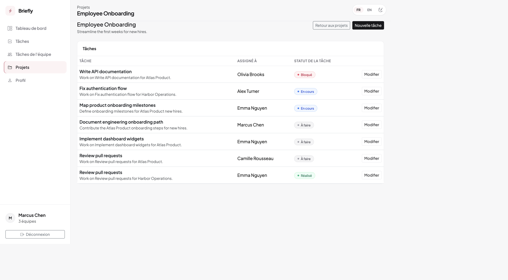{width=14cm}

**Figure 4.19** – Détail d’un projet et tâches de l’équipe (`/projects/{id}`)

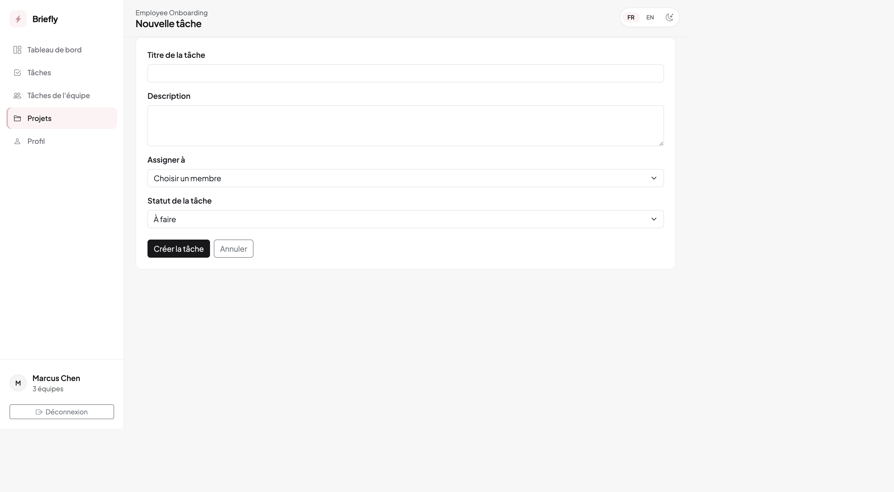{width=14cm}

**Figure 4.20** – Création ou édition d’une tâche par le chef d’équipe

La page `/team/tasks` combine des compteurs, un filtre par statut (tous, bloqué, en cours, à faire, terminé) et un tableau (membre, tâche, projet, avancement, blocage). Lorsqu’un chef dirige plusieurs équipes, une colonne « Équipe » distingue les lignes. La fiche membre rassemble les tâches assignées et l’historique d’avancement de la personne.

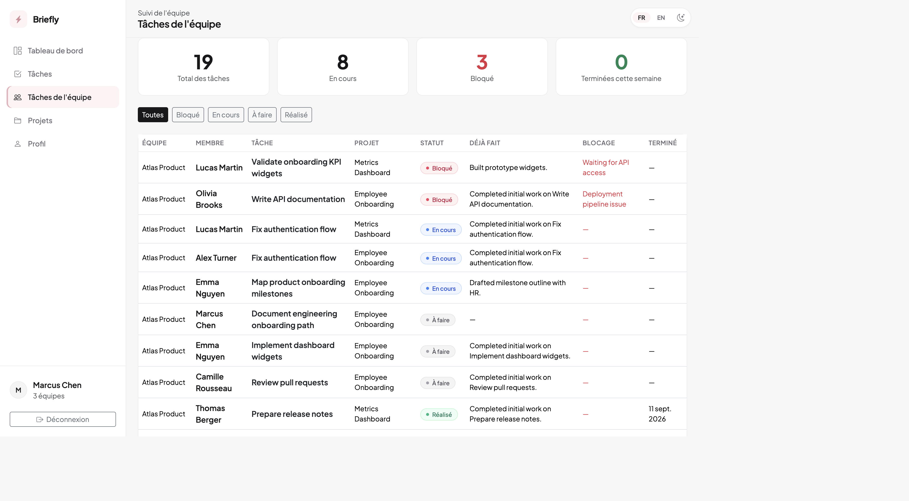{width=14cm}

**Figure 4.21** – Suivi des tâches d’équipe avec filtre de statut (`/team/tasks`)

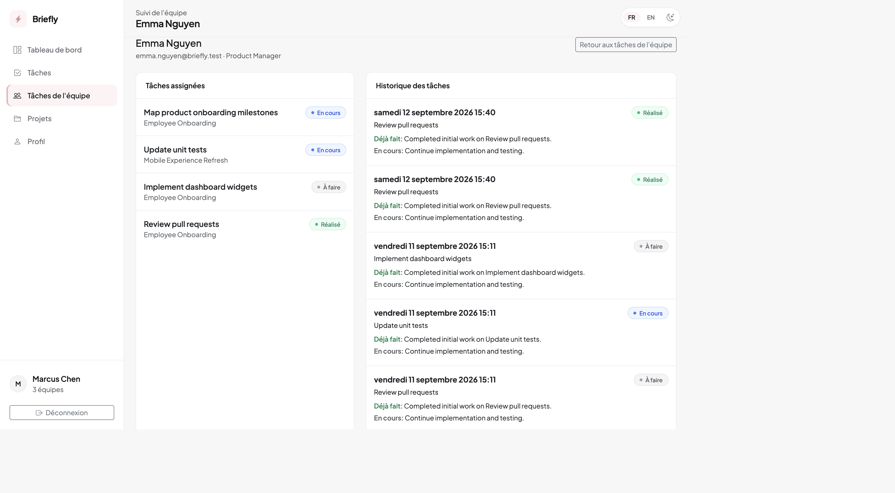{width=14cm}

**Figure 4.22** – Fiche d’un membre d’équipe (`/team/members/{user}`)

**Tableau 4.6** – Tests fonctionnels du sprint 3

| Cas de test | Démarche | Comportement attendu | Résultat |
| --- | --- | --- | --- |
| Création de projet interdite | Poster une création de projet en tant que chef d’équipe | Réponse 403. Aucune ligne projet créée | Conforme |
| Création de tâche | Créer une tâche pour un membre de l’équipe, sur un projet rattaché | Redirection vers le projet. Tâche persistée | Conforme |
| Assignation hors équipe | Assigner la tâche à un membre d’une autre équipe | Erreur de validation sur `assigned_to` | Conforme |
| Liste des projets | Ouvrir `/projects` en tant que chef | Les projets des équipes dirigées s’affichent | Conforme |
| Projet partagé | Diriger deux équipes liées au même projet | Les deux noms d’équipe apparaissent sur l’index | Conforme |
| Tâches d’équipe | Ouvrir `/team/tasks` | Les tâches des membres et leurs noms sont visibles | Conforme |
| Plusieurs équipes | Chef de deux équipes, ouvrir `/team/tasks` | Colonne « Équipe » et tâches des deux équipes | Conforme |
| Tableau de bord chef | Ouvrir `/dashboard` avec des tâches d’équipe | Blocs « Avancement des membres » et « Avancement des projets » | Conforme |
| Tâches personnelles du chef | Ouvrir `/tasks` en tant que chef | Uniquement ses propres tâches. Pas celles des membres | Conforme |
| Consultation sans formulaire | Ouvrir le détail d’une tâche d’un membre | La page s’affiche sans le formulaire d’avancement | Conforme |
| Drapeau chef absent | Rôle chef d’équipe mais `is_team_lead` faux sur le pivot | Accès à `/projects` refusé (403) | Conforme |

### Sprint 4 : Espace administrateur

L’écran `/admin` présente les effectifs, le taux d’avancement global, les listes d’avancement par projet et par équipe, ainsi qu’un graphique de répartition des statuts (Chart.js). Un membre ne peut pas accéder à ces routes. Un administrateur qui ouvre `/tasks` est renvoyé vers `/admin`.

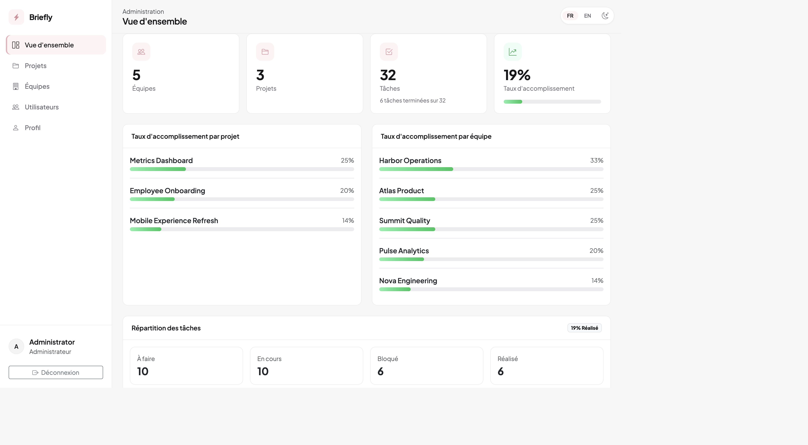{width=14cm}

**Figure 4.23** – Tableau de bord administrateur : statistiques, achèvement et graphiques (`/admin`)

Les pages utilisateurs, équipes et projets permettent de créer et de mettre à jour ces entités. La gestion des utilisateurs liste les comptes, autorise la création (nom, courriel, mot de passe, équipes) et la mise à jour (équipes d’appartenance, drapeaux chef d’équipe). La gestion des équipes permet de nommer l’équipe, d’y rattacher des membres, de désigner un chef et d’associer des projets. Un chef ne peut pas être retiré de sa dernière équipe. La gestion des projets crée ou met à jour un projet et synchronise les équipes associées.

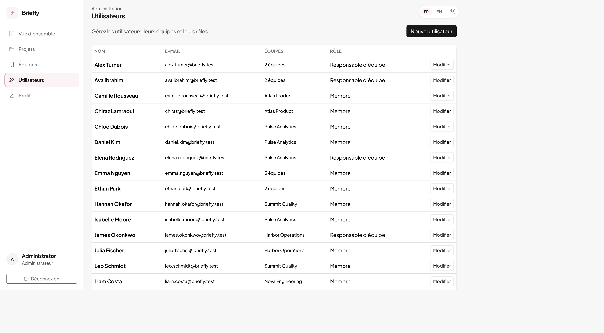{width=14cm}

**Figure 4.24** – Gestion des utilisateurs (`/admin/users`)

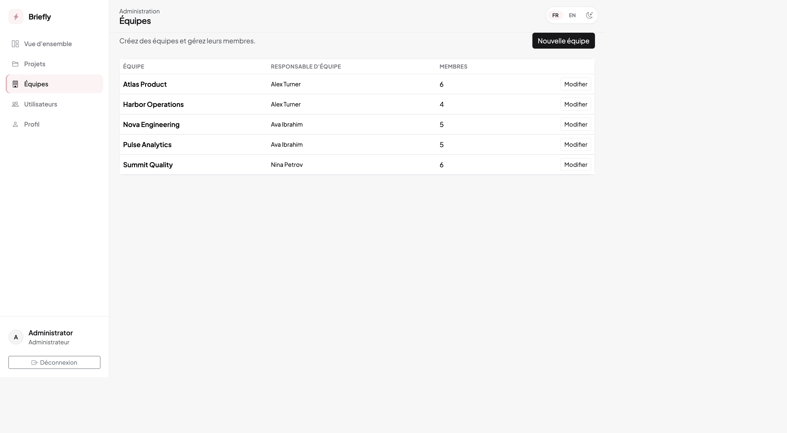{width=14cm}

**Figure 4.25** – Gestion des équipes (`/admin/teams`)

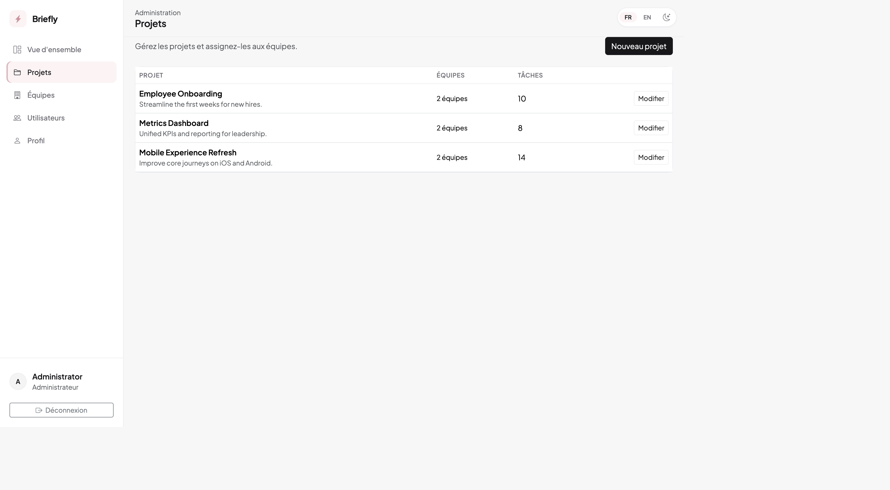{width=14cm}

**Figure 4.26** – Gestion des projets (`/admin/projects`)

**Tableau 4.7** – Tests fonctionnels du sprint 4

| Cas de test | Démarche | Comportement attendu | Résultat |
| --- | --- | --- | --- |
| Tableau de bord admin | Se connecter en administrateur et ouvrir `/admin` | Affichage de la vue d’ensemble, du taux d’avancement, du graphique de statuts et des listes par équipe et par projet | Conforme |
| Membre exclu | Ouvrir `/admin` en tant que membre | Réponse 403 | Conforme |
| Redirection de l’admin | Ouvrir `/tasks` en tant qu’administrateur | Redirection vers `/admin` | Conforme |
| Création et mise à jour d’un projet | Créer un projet multi-équipes puis n’en conserver qu’une | Redirections vers l’index puis l’édition. Équipes synchronisées | Conforme |
| Chef interdit de créer un projet | Poster `/admin/projects` en tant que chef d’équipe | Réponse 403 | Conforme |
| Création d’équipe | Poster un nom d’équipe | L’équipe est enregistrée. Redirection vers l’index | Conforme |
| Équipe avec chef et membres | Créer une équipe en désignant un chef et un membre | Rôle chef, pivot `is_team_lead`, appartenances correctes | Conforme |
| Utilisateur multi-équipes | Créer un utilisateur avec deux équipes | Les deux appartenances sont persistées | Conforme |
| Membre interdit de créer un compte | Poster `/admin/users` en tant que membre | Réponse 403 | Conforme |
| Assignation multi-équipes | Mettre à jour un membre avec deux `team_ids` | Appartenance aux deux équipes. Rôle membre conservé | Conforme |
| Chef de plusieurs équipes | Cocher deux `team_lead_ids` pour un utilisateur | Rôle chef d’équipe. Drapeaux vrais sur les deux équipes | Conforme |
| Retrait du dernier chef | Mettre à jour une équipe en vidant `user_ids` alors qu’un chef y est encore | Erreur de validation. Le chef reste rattaché | Conforme |
| URL d’équipe | Ouvrir `/admin/teams/{id}` | Redirection vers le formulaire d’édition | Conforme |

### Sprint 5 : Tests, sécurité et intégration continue

Après le client web (sprints 1 à 4), nous avons consolidé PHPUnit, formalisé la sécurité (§4.3) et branché la CI (§4.4), conformément au tableau 2.1 (27 avril au 25 juillet 2026).

### Sprint 6 : Application mobile

Le client Flutter reprend les parcours du tableau 2.1. Il a été développé en septembre et début octobre 2026, en lien avec le module mobile en formation. Le jeton Sanctum est stocké de façon sécurisée. Un administrateur est redirigé de `/dashboard` et `/tasks` vers `/admin`. Le thème et la langue FR/EN se règlent dans le profil (stockage local). Ils ne changent pas la locale Laravel.

{width=7.5cm}

**Figure 4.27** – Connexion mobile (`LoginScreen`)

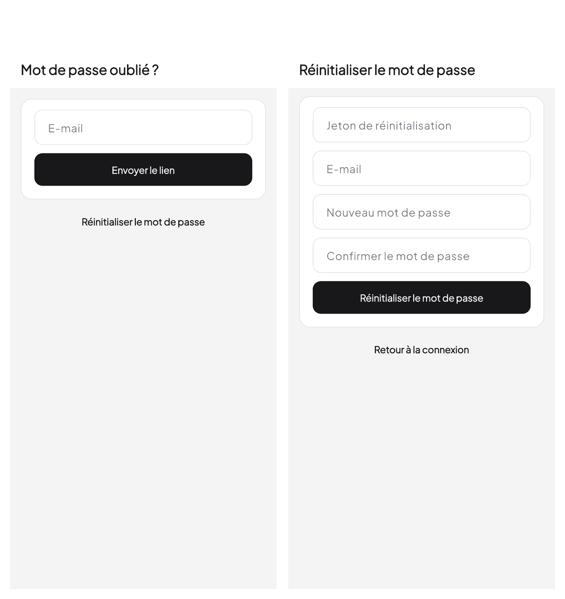{width=14cm}

**Figure 4.28** – Mot de passe oublié et réinitialisation (`ForgotPasswordScreen`, `ResetPasswordScreen`)

Sur le tableau de bord chef d’équipe, les pastilles mobiles affichent en cours / bloqué / terminé, sans le total ni « terminé cette semaine » du web.

{width=7.5cm}

**Figure 4.29** – Tableau de bord mobile : anneau d’achèvement et tâches (`DashboardScreen`)

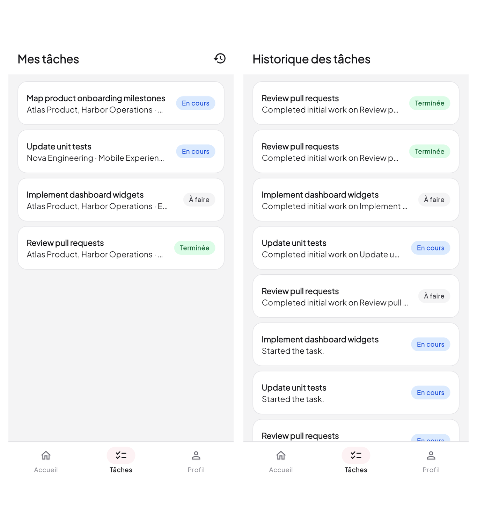{width=14cm}

**Figure 4.30** – Liste des tâches et historique (`TaskListScreen`, `TaskHistoryScreen`)

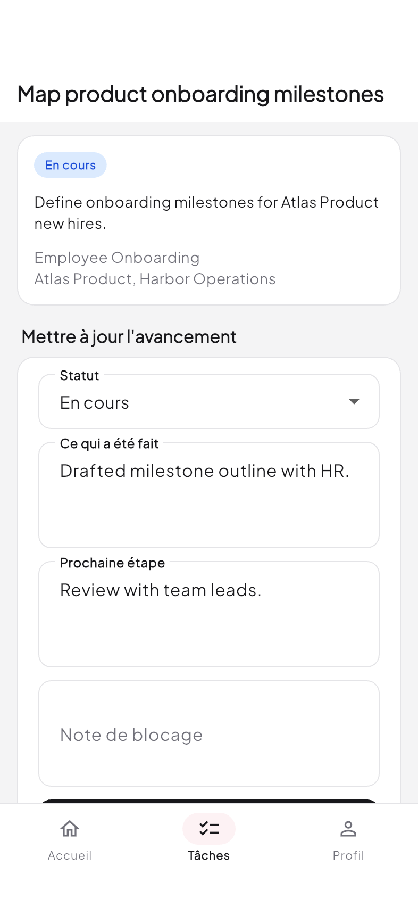{width=7.5cm}

**Figure 4.31** – Détail de tâche et saisie d’avancement (`TaskDetailScreen`)

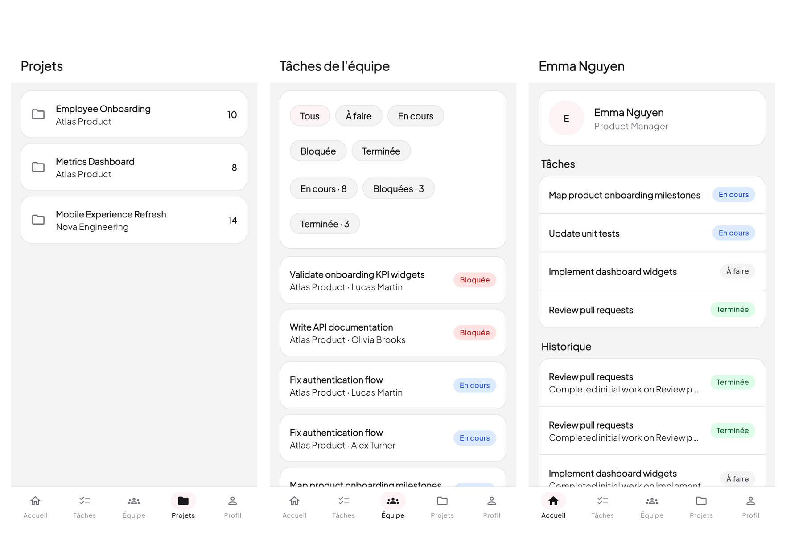{width=14cm}

**Figure 4.32** – Projets, tâches d’équipe et fiche membre (`ProjectListScreen`, `TeamTasksScreen`, `TeamMemberScreen`)

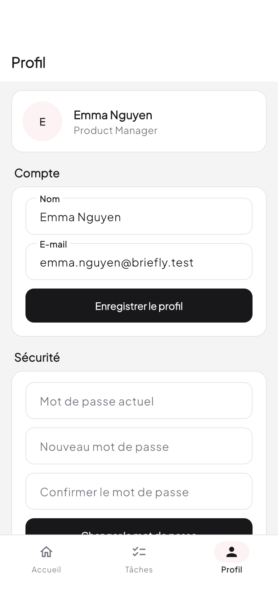{width=7.5cm}

**Figure 4.33** – Profil, thème et langue FR/EN (`ProfileScreen`)

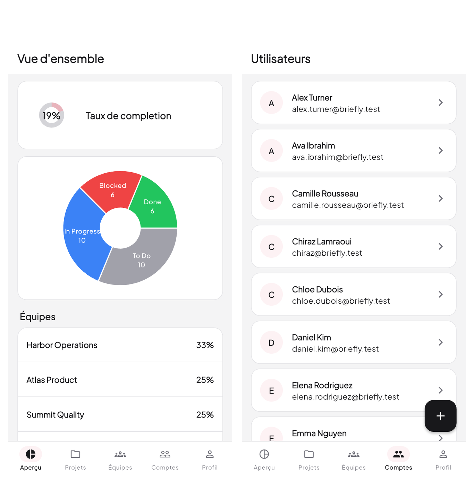{width=14cm}

**Figure 4.34** – Écrans d’administration mobile (`AdminDashboardScreen` et listes CRUD)

Les scénarios ci-dessous complètent le tableau 4.4. La connexion JSON y est déjà testée au sprint 1. Ils valident le contrat métier dont le client Flutter dépend.

**Tableau 4.8** – Tests fonctionnels du sprint 6 (API JSON consommée par le mobile)

| Cas de test | Démarche | Comportement attendu | Résultat |
| --- | --- | --- | --- |
| Tableau de bord sans jeton | GET JSON `/dashboard` sans `Authorization` | Réponse 401 | Conforme |
| Avancement avec jeton | GET JSON du tableau de bord puis PATCH d’une tâche assignée | 200. Statut et réalisé mis à jour | Conforme |
| Blocage JSON sans note | PATCH JSON statut « bloqué » sans note | Réponse 422 sur `blocker_note` | Conforme |
| Admin hors tâches membre | GET JSON `/tasks` avec un jeton administrateur | Réponse 403 | Conforme |
| Membre hors projets | GET JSON `/projects` avec un jeton membre | Réponse 403 | Conforme |
| Création de tâche JSON | Poster une tâche en tant que chef d’équipe | Réponse 201. Titre persisté | Conforme |
| Liste d’équipe JSON | GET JSON `/team/tasks` en tant que chef | Compteurs et fragment de titre présents | Conforme |
| CRUD admin JSON | Créer un utilisateur, une équipe et un projet en JSON | Réponses 201. Enregistrements en base | Conforme |
| Déconnexion | POST JSON `/logout` puis GET `/dashboard` | 204. Jeton révoqué. Accès ultérieur 401 | Conforme |

## 4.3 Sécurité de l’application

Le chapitre 3 avait déjà placé l’autorisation sur le serveur. Nous détaillons ici le code retenu, puis les limites de la version actuelle.

### 4.3.1 Mots de passe

Le modèle `User` déclare le cast `password => hashed` (figure 4.35). Laravel hache donc le mot de passe avec bcrypt, à 12 tours (`BCRYPT_ROUNDS`), dès qu’il est affecté, à la création d’un compte comme lors d’un changement de mot de passe. Aucun mot de passe n’est stocké en clair. L’attribut `#[Hidden]` retire `password` et `remember_token` de toute sérialisation, y compris des réponses JSON envoyées au mobile.

Les formulaires imposent huit caractères au minimum et une confirmation : `StoreUserRequest` à la création d’un compte, `NewPasswordController` à la réinitialisation, `UpdatePasswordRequest` au changement depuis le profil. Ce dernier exige aussi le mot de passe actuel (règle `current_password`).

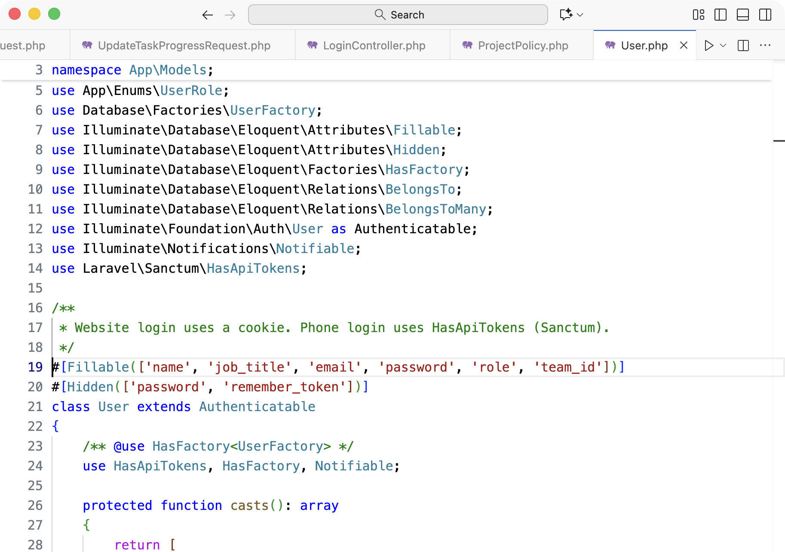{width=15cm}

**Figure 4.35** – Cast `hashed` et attributs masqués (`app/Models/User.php`)

### 4.3.2 Session et jeton

Après une connexion réussie, `LoginController` régénère l’identifiant de session, ce qui empêche la fixation de session. La déconnexion invalide la session et régénère le jeton CSRF.

Pour le mobile, la même méthode crée un jeton Sanctum (figure 4.36). Sanctum n’enregistre en base que l’empreinte SHA-256 du jeton, dans `personal_access_tokens`. Le texte clair n’est renvoyé qu’une fois, dans la réponse de connexion. Le client Flutter le range dans `flutter_secure_storage`, qui s’appuie sur le trousseau d’iOS. La déconnexion JSON supprime le jeton côté serveur.

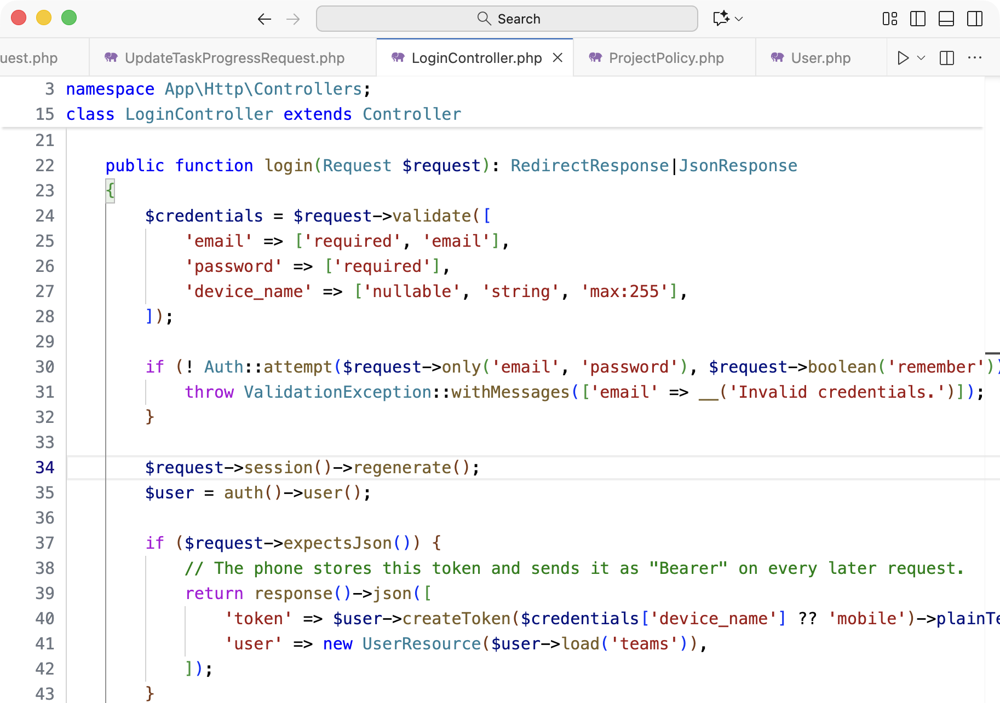{width=15cm}

**Figure 4.36** – Émission du jeton Sanctum à la connexion mobile (`app/Http/Controllers/LoginController.php`)

### 4.3.3 Protection CSRF

Les formulaires Blade portent le jeton CSRF (`@csrf`), que vérifie le middleware `VerifyCsrfToken`. Le client mobile ne dispose pas de ce jeton de formulaire. Le middleware exempte donc deux cas, et seulement ceux-là (figure 4.37) : les requêtes munies d’un jeton Bearer, et les requêtes JSON vers `login`, `forgot-password` et `reset-password`, qui précèdent l’obtention du jeton.

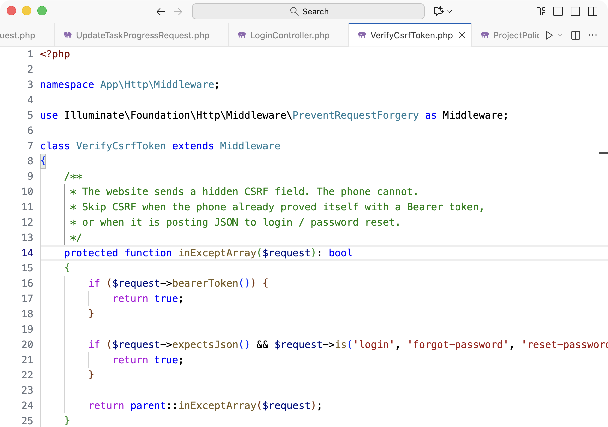{width=15cm}

**Figure 4.37** – Exemptions CSRF pour le client mobile (`app/Http/Middleware/VerifyCsrfToken.php`)

### 4.3.4 Contrôle d’accès

Trois niveaux s’enchaînent. Le middleware `auth:web,sanctum` refuse toute requête sans session ni jeton : redirection vers `/login` sur le web, réponse 401 en JSON. Les middleware de rôle du tableau 3.1 filtrent ensuite des groupes de routes entiers. `EnsureAdmin` (figure 4.38) refuse tout utilisateur qui n’est pas administrateur avec une réponse 403. `EnsureTeamLead` fait de même pour les routes de chef d’équipe. Les politiques décident ensuite au niveau de la ressource : `TaskPolicy::updateStatus` réserve l’avancement à l’assigné (figure 4.3), et `ProjectPolicy::view` n’accorde un projet qu’à un chef dont une équipe dirigée y est liée (figure 4.39).

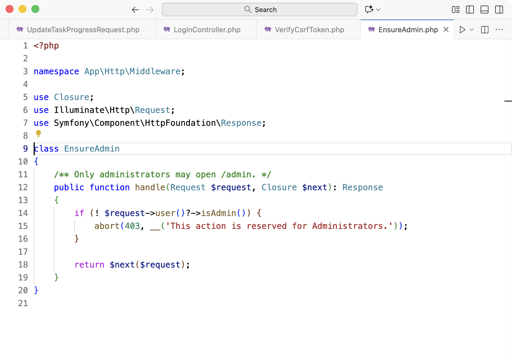{width=15cm}

**Figure 4.38** – Middleware `EnsureAdmin` (`app/Http/Middleware/EnsureAdmin.php`)

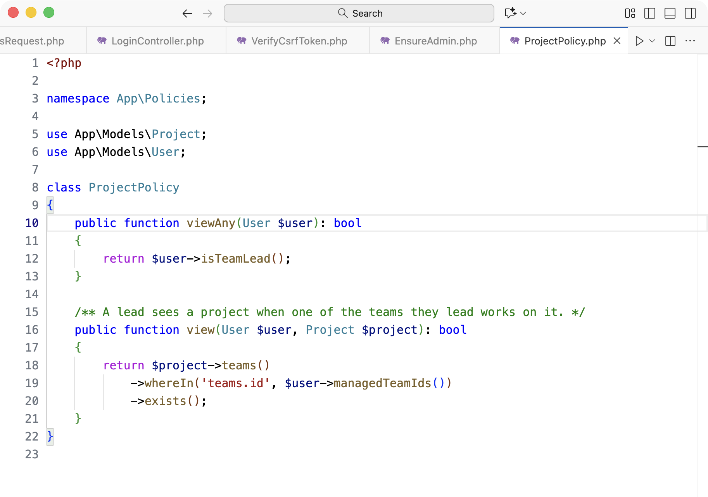{width=15cm}

**Figure 4.39** – Politique `view` d’un projet (`app/Policies/ProjectPolicy.php`)

Ces contrôles s’appuient sur le modèle `User`. `isAdmin()` lit le rôle. `isTeamLead()` vérifie qu’au moins une ligne `team_user` porte `is_team_lead` (figure 4.40).

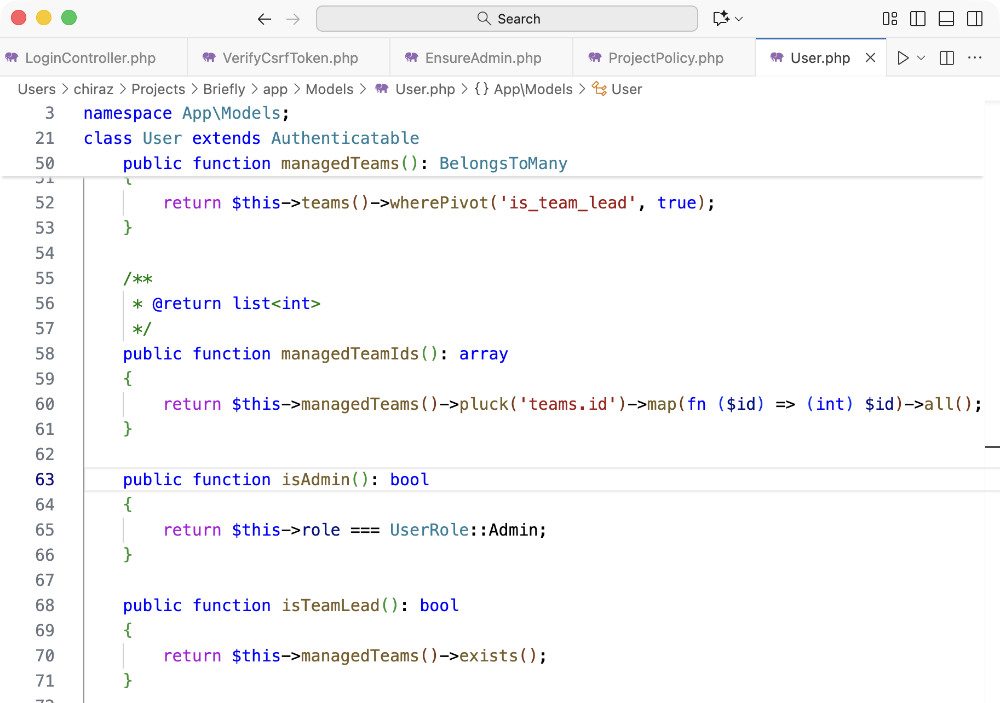{width=15cm}

**Figure 4.40** – Méthodes `isAdmin()` et `isTeamLead()` (`app/Models/User.php`)

Lors de la création d’une tâche, `TaskService::ensureAssigneeOnTeam` refuse un assigné qui n’appartient pas à l’équipe de contexte (figure 4.41). C’est la règle derrière le fragment « alt » de la figure 3.5.

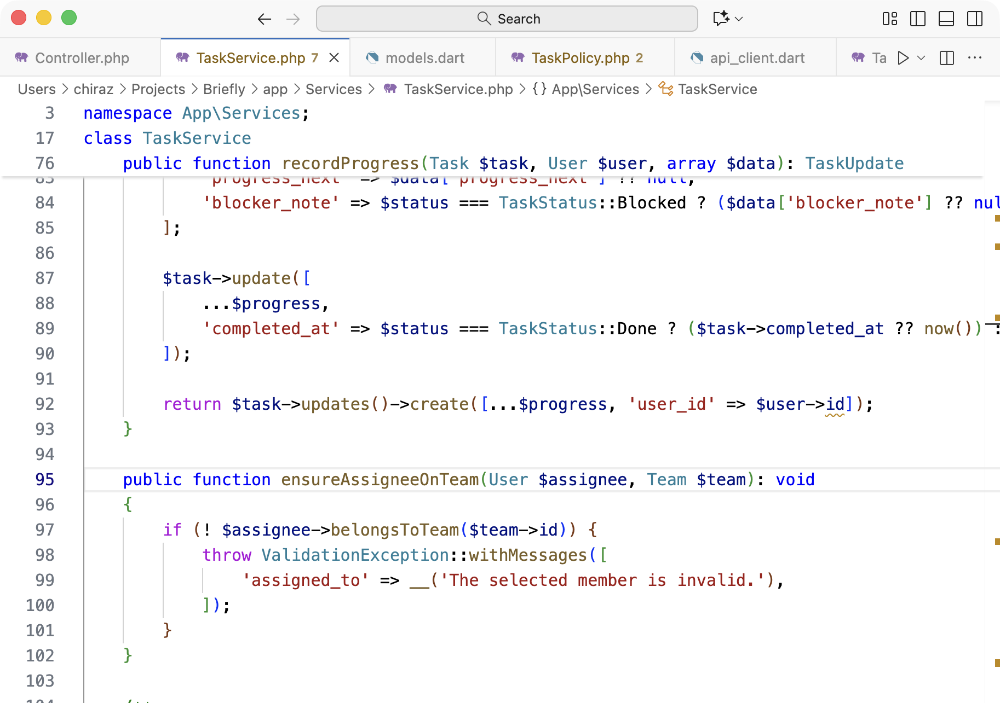{width=15cm}

**Figure 4.41** – Vérification que l’assigné appartient à l’équipe (`app/Services/TaskService.php`)

Côté mobile, le client Flutter applique la même règle de note de blocage avant l’envoi (figure 4.42). C’est un confort d’interface. Le serveur reste l’autorité, via `UpdateTaskProgressRequest` (figure 4.7).

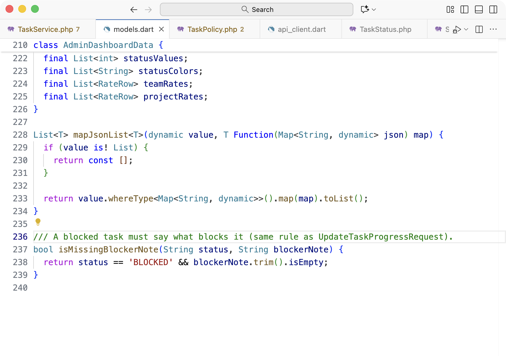{width=15cm}

**Figure 4.42** – Contrôle local de la note de blocage (`mobile/lib/models/models.dart`)

Les tableaux 4.4 à 4.8 vérifient ces refus par des réponses 401 et 403.

### 4.3.5 Formulaires et données

Eloquent transmet les valeurs à MySQL par des requêtes préparées (PDO), ce qui protège contre l’injection SQL. Les seules expressions SQL brutes du code, deux `orderByRaw` dans `TaskService`, sont des constantes qui ne contiennent aucune donnée saisie. Les vues Blade affichent les données avec `{{ }}`, qui échappe le HTML. Aucune vue n’emploie la syntaxe non échappée `{!! !!}`. Enfin, chaque écriture est validée avant toute mutation : par un Form Request pour les profils, les comptes, les équipes, les projets et les tâches, par `validate()` dans les contrôleurs de connexion et de réinitialisation du mot de passe.

Le tableau 4.9 résume ces mesures.

**Tableau 4.9** – Mesures de sécurité de Briefly

| Risque | Mesure | Emplacement |
| --- | --- | --- |
| Vol de la base de données | Mots de passe hachés avec bcrypt. Jetons stockés sous forme d’empreinte | `User::casts()`, Sanctum |
| Fuite de secrets dans les réponses | `password` et `remember_token` masqués | `#[Hidden]` sur `User` |
| Fixation de session | Régénération de la session à la connexion, invalidation à la déconnexion | `LoginController` |
| Accès sans authentification | Garde `auth:web,sanctum` sur toutes les routes métier | `routes/web.php` |
| Élévation de privilèges | Middleware de rôle, puis politiques par ressource | `EnsureAdmin`, `EnsureTeamLead`, `EnsureNotAdmin`, `TaskPolicy`, `ProjectPolicy` |
| Falsification de requête (CSRF) | Jeton `@csrf` vérifié sur les formulaires web | `VerifyCsrfToken` |
| Injection SQL | Requêtes préparées par Eloquent | Modèles et services |
| Injection de script (XSS) | Échappement systématique par `{{ }}` | Vues Blade |
| Données invalides | Validation avant écriture | Form Requests de `app/Http/Requests`, `validate()` des contrôleurs d’authentification |

### 4.3.6 Limites

Deux points restent à traiter. La route `POST /login` ne limite pas le nombre de tentatives : aucun limiteur de débit (`RateLimiter` ou middleware `throttle`) ne la protège contre les essais répétés. Les jetons Sanctum n’expirent pas, puisque `expiration` vaut `null` dans `config/sanctum.php`. Un jeton reste valide jusqu’à la déconnexion. Ces deux limites figurent parmi les perspectives.

## 4.4 Intégration continue

Le dépôt est branché sur GitHub Actions via `.github/workflows/ci.yml`. Il se déclenche à chaque `push` sur la branche `main` et à chaque *pull request*. Deux jobs indépendants s’exécutent en parallèle sur une machine Ubuntu (tableau 4.10).

**Tableau 4.10** – Jobs du workflow d’intégration continue

| Job | Environnement | Étapes |
| --- | --- | --- |
| Tests Laravel | PHP 8.5, extensions `mbstring`, `pdo_sqlite` et `pdo_mysql` | `composer install`, copie de `.env.example` et `php artisan key:generate`, puis `php artisan test` |
| Tests Flutter | Flutter 3.47.1 (canal stable), dossier `mobile/` | `flutter pub get`, `flutter analyze`, puis `flutter test` |

Le job Laravel exécute la suite PHPUnit des tableaux 4.4 à 4.8 sur une base SQLite en mémoire, comme en local, grâce à la configuration de `phpunit.xml`. Le job Flutter lance l’analyse statique du code Dart, puis les tests `auth_gate_test.dart` et `progress_validation_test.dart`. Une modification qui casse une règle d’accès ou de validation fait échouer le workflow, et l’échec apparaît dans la *pull request* concernée.

## Conclusion

Les six sprints du tableau 2.1 ont été réalisés : socle web (authentification, membre, chef d’équipe, administration), consolidation PHPUnit et sécurité (§4.3), intégration continue (§4.4), puis client Flutter et mise en ligne (chapitre 5). Les tests confirment les refus 401, 403 et 422 et les règles d’avancement ; les figures 4.1 à 4.42 illustrent code et écrans. La limitation des tentatives de connexion et l’expiration des jetons Sanctum restent ouvertes (§4.3.6).
