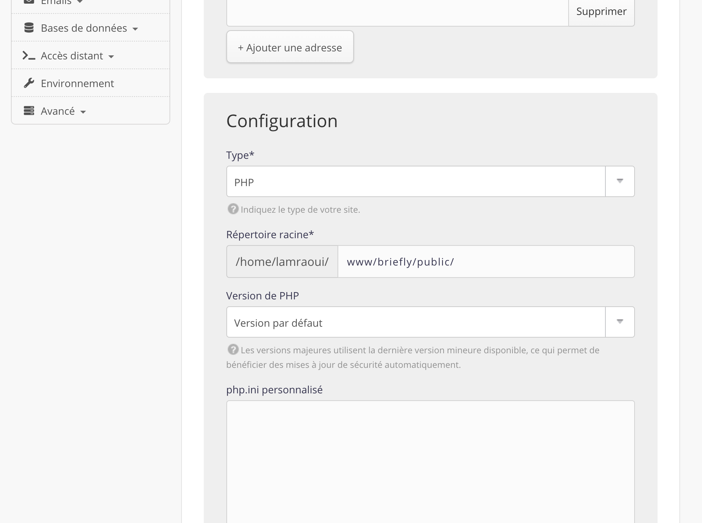
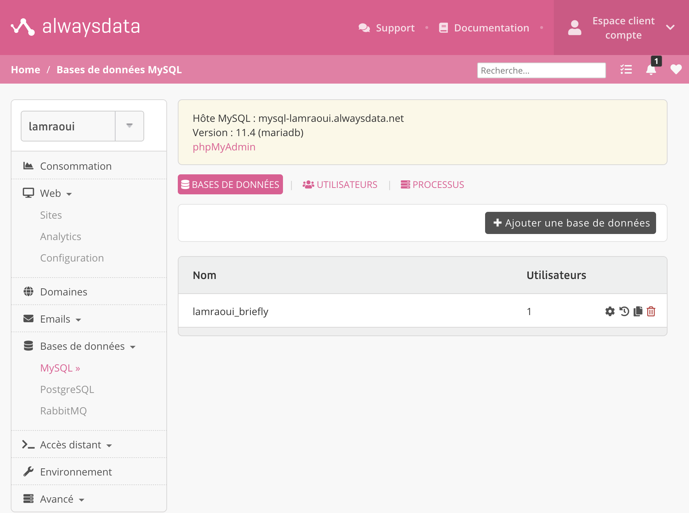
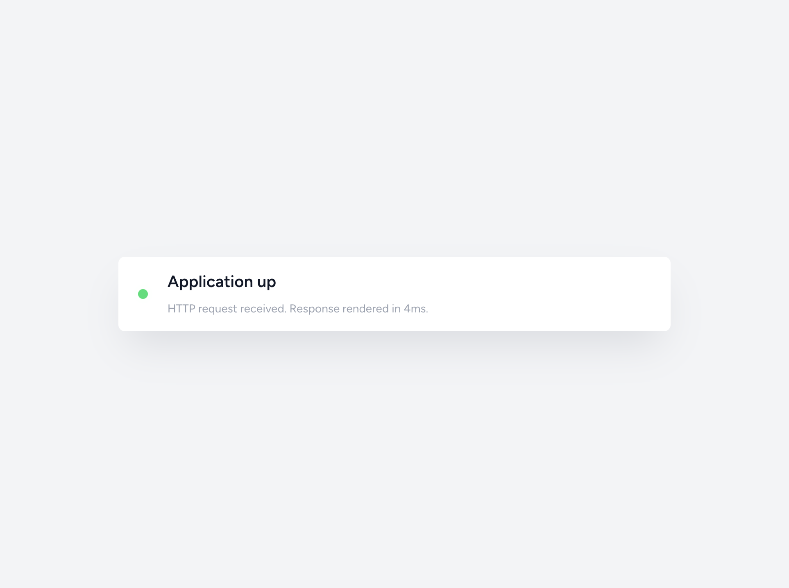
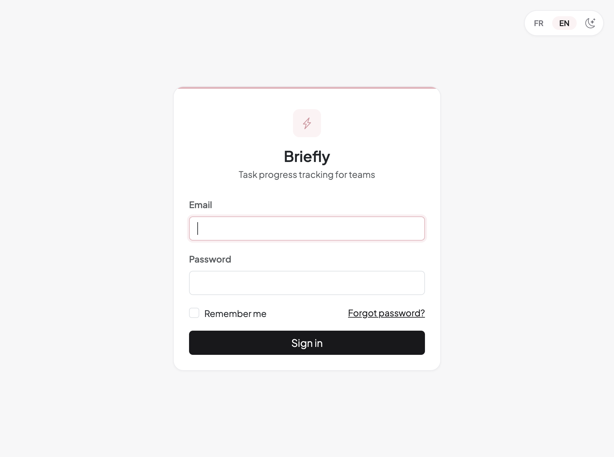
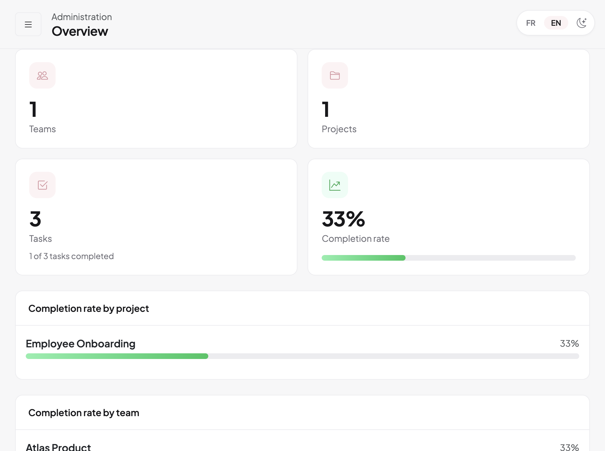
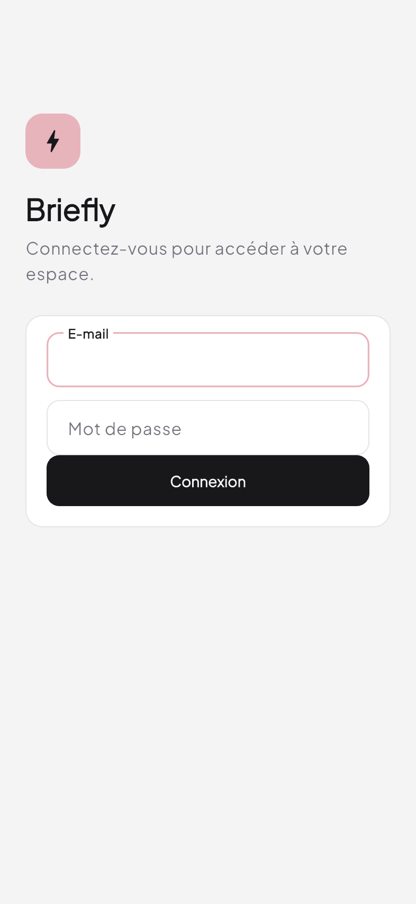
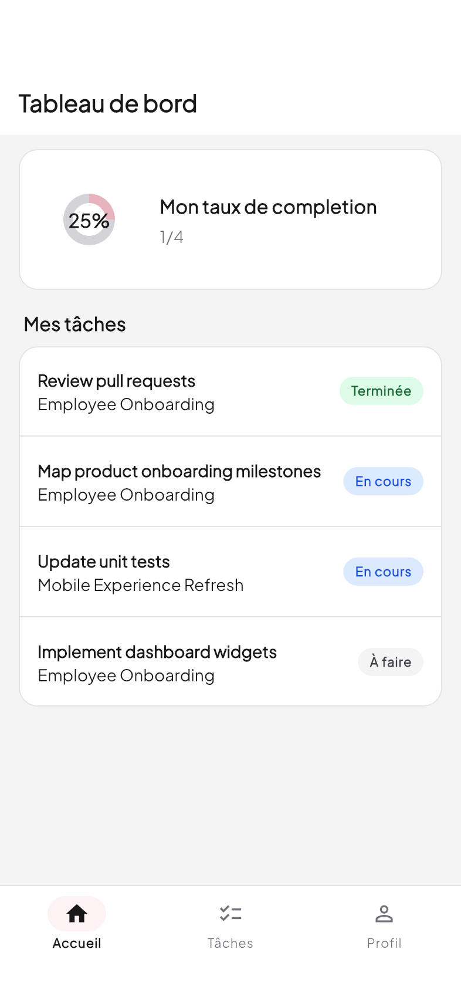

# Chapitre 5 : Déploiement

## Introduction

Les chapitres 3 et 4 décrivent Briefly sur le poste de développement. Nous avons ensuite mis le serveur en ligne et branché l’application mobile sur cette adresse. Le navigateur et le téléphone joignent ce même serveur. Ce chapitre présente l’hébergement retenu, les grandes étapes de mise en production et les contrôles réalisés sur le web et sur iPhone.

## 5.1 Choix d’hébergement

Briefly est une application PHP avec une base relationnelle. Le site est servi depuis le dossier `public/`, en HTTPS, et les mises à jour passent par SSH. L’application n’a pas de worker de file d’attente et ne compile pas de ressources front. L’hébergement doit couvrir ces besoins.

Nous avons retenu alwaysdata, compte `lamraoui`, à l’adresse https://lamraoui.alwaysdata.net [26]. Ce compte fournit déjà PHP 8.5, MariaDB 11.4, un accès SSH et un certificat sur le sous-domaine, sans frais supplémentaires [27].

Les réglages suivent ce choix. PHP 8.5 et MariaDB 11.4 portent le serveur et la base `lamraoui_briefly`. La racine web pointe sur `www/briefly/public/`. `APP_ENV` vaut `production` et `APP_DEBUG` vaut `false`. Les sessions et le cache restent en base (`SESSION_DRIVER=database`, `CACHE_STORE=database`). La file d’attente est synchrone (`QUEUE_CONNECTION=sync`). L’interface web charge Bootstrap et Chart.js depuis un CDN, donc le déploiement n’exécute pas `npm`.

**Tableau 5.1** – Environnement de production

| Élément | Valeur |
| --- | --- |
| URL publique | https://lamraoui.alwaysdata.net |
| PHP | 8.5 |
| SGBD | MariaDB 11.4, base `lamraoui_briefly` |
| Racine web | `www/briefly/public/` |
| `APP_ENV` / `APP_DEBUG` | `production` / `false` |

## 5.2 Installation sur le serveur

Dans l’administration alwaysdata, nous avons créé une base MariaDB et un site PHP. La racine documentaire pointe sur `public/` de Laravel (figures 5.1 et 5.2). Le code a été copié depuis le Mac vers `~/www/briefly/` par SSH, sans le dossier `mobile/` ni `docs/`. Le fichier `.env` a été rédigé sur le serveur à partir de `.env.example`, avec les paramètres de connexion à la base et `APP_URL` en HTTPS.

Sur le serveur, nous avons enchaîné `composer install --no-dev --optimize-autoloader`, `php artisan key:generate --force`, `php artisan migrate --force` et `php artisan optimize`. La migration crée les tables métier et Sanctum. Le seeder du dépôt ne tourne pas lorsque `APP_ENV` vaut `production` : les comptes de démonstration du poste local ne sont pas recréés en ligne. Un administrateur a été créé manuellement pour les essais. Les dossiers `storage/` et `bootstrap/cache/` doivent rester inscriptibles pour le compte SSH.

**Tableau 5.2** – Variables d’environnement principales en production

| Variable | Rôle |
| --- | --- |
| `APP_URL` | URL HTTPS du site |
| `DB_*` | Connexion MariaDB alwaysdata |
| `SESSION_DRIVER` / `CACHE_STORE` | `database` |
| `QUEUE_CONNECTION` | `sync` |
| `MAIL_MAILER` | `log` (courriel non envoyé, voir §5.5) |

{width=15cm}

**Figure 5.1** – Site PHP : racine `www/briefly/public/`

{width=15cm}

**Figure 5.2** – Base `lamraoui_briefly`

## 5.3 Vérification côté web

Avant usage, nous avons contrôlé que l’application répondait et qu’un parcours administrateur fonctionnait en HTTPS. La route Laravel `GET /up` renvoie 200 lorsque l’application démarre correctement (figure 5.3). La page de connexion s’affiche avec un certificat valide. Après authentification, le tableau de bord administrateur reprend les mêmes règles qu’en local (§4.3) : statistiques, projets et tâches issus de la base en ligne (figures 5.4 et 5.5).

{width=14cm}

**Figure 5.3** – Réponse de `GET /up`

{width=12cm}

**Figure 5.4** – Page de connexion

{width=14cm}

**Figure 5.5** – Tableau de bord administrateur

Les tests JSON décrits au sprint 6 (tableau 4.8) ont aussi été rejoués contre l’URL publique : connexion avec `Accept: application/json`, émission d’un jeton Sanctum, refus 401 sans jeton. Le contrat reste celui validé au chapitre 4.

## 5.4 Application mobile sur iPhone

Cette mise en ligne clôt le sprint 6 du tableau 2.1 (septembre–début octobre 2026). Une fois le serveur en HTTPS, le mobile n’a plus besoin du réseau local du Mac ni de `php artisan serve`. La classe `ApiConfig` fixe l’URL de production (`https://lamraoui.alwaysdata.net`) ; un `--dart-define=API_BASE_URL=...` reste possible pour les essais en LAN (§4.1). L’application a été installée sur un iPhone physique en mode release, avec la signature Xcode du projet `mobile/ios`. Le jeton Sanctum est stocké comme en développement (§4.3.2).

Nous avons ouvert les écrans de connexion et de tableau de bord contre le serveur en ligne (figures 5.6 et 5.7). Les listes et pourcentages proviennent des mêmes routes JSON que sur le poste local.

{width=7.5cm}

**Figure 5.6** – Connexion mobile (`LoginScreen`)

{width=7.5cm}

**Figure 5.7** – Tableau de bord mobile (`DashboardScreen`)

## 5.5 Exploitation et limites

Un push sur `main` lance le workflow GitHub Actions (§4.4). Les tests Laravel et Flutter s’exécutent d’abord. S’ils réussissent, `scripts/deploy-alwaysdata.sh` copie le code vers `~/www/briefly/` par SSH, sans écraser le `.env`, puis lance `php artisan migrate --force` et `php artisan optimize`. Les dossiers `mobile/` et `docs/` ne partent pas sur le serveur. Une pull request lance les tests et laisse le serveur en l’état. Les liens de réinitialisation de mot de passe ne partent pas par courriel : `MAIL_MAILER` vaut `log`. Un envoi réel pourrait utiliser le SMTP du compte alwaysdata. Avec `QUEUE_CONNECTION=sync`, aucune tâche asynchrone longue n’est prévue dans cette version.

## Conclusion du chapitre

Briefly est accessible sur https://lamraoui.alwaysdata.net pour le navigateur et depuis l’application Flutter installée sur iPhone. L’hébergement alwaysdata couvre PHP, MariaDB et HTTPS ; le déploiement Laravel repose sur une racine `public/`, un `.env` de production et les migrations Artisan. Le mobile rejoint le même serveur que le navigateur et s’authentifie par un jeton d’accès. Les captures de ce chapitre montrent un parcours web et mobile cohérent sur ce serveur. Un push sur `main` publie cette version après les tests du chapitre 4. Le courriel de réinitialisation est journalisé.
